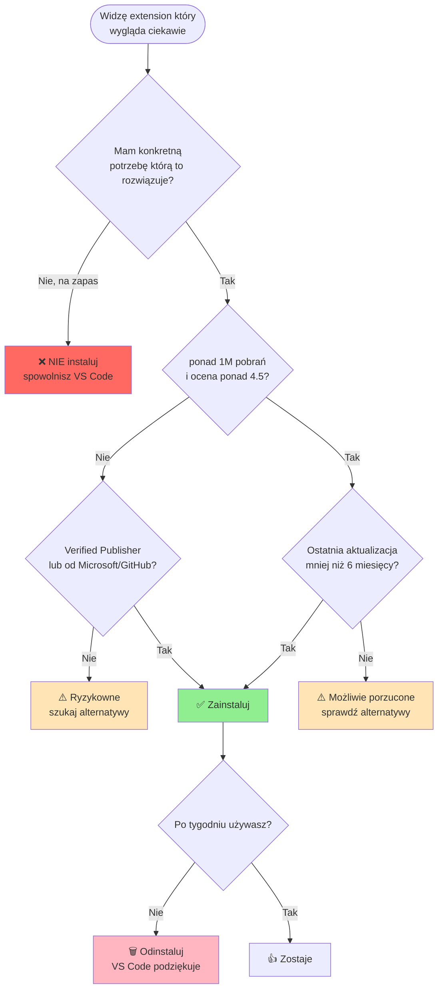
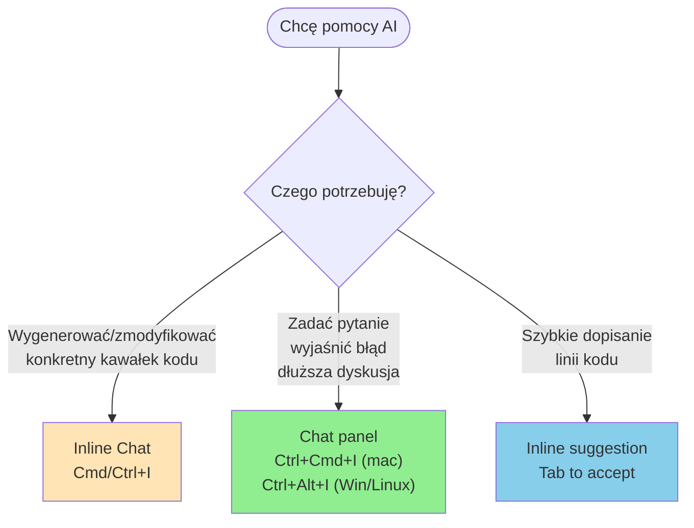
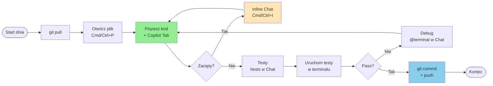

# Visual Studio Code + GitHub Copilot

---

## 📋 Spis treści

### **Część 1: Pierwsze kroki z VS Code**
1. **[Czym jest Visual Studio Code](#1-czym-jest-visual-studio-code)**
   - VS Code vs Visual Studio vs inne edytory
   - Dlaczego warto się go nauczyć
   - Filozofia: edytor + extensions

2. **[Instalacja](#2-instalacja-krok-po-kroku)**
   - macOS, Windows, Linux
   - Dodanie do PATH (`code .` z terminala)
   - Pierwsze uruchomienie

3. **[Pierwsza konfiguracja](#3-pierwsza-konfiguracja)**
   - Wybór motywu (jasny/ciemny)
   - Język interfejsu
   - Synchronizacja ustawień (Settings Sync)

### **Część 2: Interfejs i nawigacja**
4. **[Anatomia interfejsu](#4-anatomia-interfejsu)**
   - Activity Bar, Side Bar, Editor, Panel, Status Bar
   - Co jest gdzie i po co

5. **[Otwieranie projektów](#5-otwieranie-projekt%C3%B3w)**
   - Plik vs folder vs workspace
   - Multi-root workspaces
   - Open Recent

6. **[Eksplorator plików i wyszukiwanie](#6-eksplorator-plik%C3%B3w-i-wyszukiwanie)**
   - File Explorer (Cmd/Ctrl+Shift+E)
   - Quick Open (Cmd/Ctrl+P)
   - Search across files (Cmd/Ctrl+Shift+F)

### **Część 3: Edycja i produktywność**
7. **[Skróty klawiszowe — najważniejsze](#7-skr%C3%B3ty-klawiszowe--najwa%C5%BCniejsze)**
   - Tabela cross-platform (mac/Windows/Linux)
   - Komendy edycji i nawigacji

8. **[Command Palette — serce VS Code](#8-command-palette--serce-vs-code)**
   - Cmd/Ctrl+Shift+P
   - Jak znaleźć dowolną funkcję

9. **[IntelliSense i auto-uzupełnianie](#9-intellisense-i-auto-uzupe%C5%82nianie)**
   - Jak działa, jak korzystać
   - Quick Fix (żarówka)

10. **[Multi-cursor i edycja równoległa](#10-multi-cursor-i-edycja-r%C3%B3wnoleg%C5%82a)**
    - Alt+klik, Cmd/Ctrl+D

### **Część 4: Terminal i Git**
11. **[Zintegrowany terminal](#11-zintegrowany-terminal)**
    - Otwieranie (` Ctrl+`` `), wiele terminali, split
    - Wybór shella (zsh/bash/PowerShell)

12. **[Git w VS Code](#12-git-w-vs-code)**
    - Source Control panel
    - Co warto robić w UI, co lepiej w terminalu
    - Link do pełnej prezentacji Git

### **Część 5: Rozszerzenia (Extensions)**
13. **[Marketplace](#13-marketplace--gdzie-szuka%C4%87)**
    - Jak instalować, oceniać, usuwać

14. **[Polecane extensions dla początkujących](#14-polecane-extensions-dla-pocz%C4%85tkuj%C4%85cych)**
    - Python, Prettier, ESLint, Live Server, Error Lens...

15. **[Settings.json — konfiguracja w pliku](#15-settingsjson--konfiguracja-w-pliku)**
    - User vs Workspace settings
    - Najczęstsze opcje

### **Część 6: GitHub Copilot (wersja Free)**
16. **[Czym jest Copilot Free](#16-czym-jest-copilot-free)**
    - Limity: 2000 completions + 50 chat / miesiąc
    - Co dostajesz za darmo

17. **[Instalacja i logowanie](#17-instalacja-copilota-i-logowanie)**
    - Konto GitHub
    - Aktywacja Copilot Free
    - Wtyczki w VS Code

18. **[Inline suggestions — autouzupełnianie kodu](#18-inline-suggestions--autouzupe%C5%82nianie-kodu)**
    - Tab = akceptuj, Esc = odrzuć
    - Alt+] / Alt+[ — kolejne propozycje

19. **[Copilot Chat — panel boczny](#19-copilot-chat--panel-boczny)**
    - Czat o kodzie, wklejanie błędów, generowanie funkcji

20. **[Inline Chat — czat bezpośrednio w kodzie](#20-inline-chat--czat-bezpo%C5%9Brednio-w-kodzie)**
    - Cmd/Ctrl+I — szybka edycja zaznaczonego fragmentu

21. **[Slash commands](#21-slash-commands--gotowe-prompty)**
    - `/explain`, `/fix`, `/tests`, `/doc`

22. **[Context variables (@ i #)](#22-context-variables---i--jak-da%C4%87-copilotowi-kontekst)**
    - `@workspace`, `@terminal`, `#file`, `#selection`

23. **[Jak pisać dobre prompty](#23-jak-pisa%C4%87-dobre-prompty-do-copilota)**
    - Zasada "co, dlaczego, w jakim formacie"
    - Przykłady dobrych vs złych

24. **[Pułapki Copilota — czego NIE ufać](#24-pu%C5%82apki-copilota--czego-nie-ufa%C4%87)**
    - Halucynacje API, błędne dane, "pewny siebie błąd"

25. **[Bezpieczeństwo i prywatność](#25-bezpiecze%C5%84stwo-i-prywatno%C5%9B%C4%87)**
    - Co Copilot wysyła
    - NIE wklejaj sekretów

### **Część 7: Dobre praktyki + ściąga**
26. **[Codzienna ścieżka pracy](#26-codzienna-%C5%9Bcie%C5%BCka-pracy-z-vs-code--copilotem)**
    - Workflow początkującego

27. **[Najczęstsze problemy i rozwiązania](#27-najcz%C4%99stsze-problemy-i-rozwi%C4%85zania)**

28. **[Szybka ściąga](#28-szybka-%C5%9Bci%C4%85ga)**
    - Top 20 skrótów
    - Top 10 komend Copilota

29. **[Glosariusz](#29-glosariusz)**
    - Słowniczek pojęć

[⬆ Powrót do góry](#visual-studio-code--github-copilot--wprowadzenie-dla-pocz%C4%85tkuj%C4%85cych)

---

## 📚 Czego się nauczysz?

✅ Zainstalować i skonfigurować VS Code na swoim systemie
✅ Poruszać się płynnie po interfejsie i znajdować dowolną funkcję
✅ Używać Command Palette i kluczowych skrótów klawiszowych
✅ Otwierać projekty, pracować z plikami i wyszukiwać w kodzie
✅ Korzystać ze zintegrowanego terminala i panelu Git
✅ Instalować i konfigurować przydatne rozszerzenia
✅ **Włączyć GitHub Copilot Free i pisać kod 2× szybciej**
✅ Korzystać z Copilot Chat, inline suggestions i slash commands
✅ Wiedzieć **kiedy ufać Copilotowi, a kiedy nie**
✅ Chronić swoje sekrety przed wyciekiem do AI

**Zaczynajmy!** 🚀

---

## 1. Czym jest Visual Studio Code

### Definicja krótko

**Visual Studio Code (VS Code)** to darmowy, otwarty edytor kodu od Microsoftu. Działa na **macOS, Windows i Linux**. Jest najpopularniejszym edytorem programistycznym świata — używa go ponad 70% deweloperów (Stack Overflow Survey 2024).

### VS Code ≠ Visual Studio

Częsta pomyłka — to **dwa różne produkty**:

| Cecha | **VS Code** | **Visual Studio** |
|---|---|---|
| Typ | Edytor kodu (lekki) | Pełne IDE (ciężkie) |
| Wielkość | ~300 MB | ~30+ GB |
| Platforma | Mac/Win/Linux | Głównie Windows |
| Cena | Darmowy | Darmowa Community / płatne wersje |
| Główne języki | Wszystko (przez extensions) | .NET, C++, C# |
| Dla początkujących | ✅ Tak | ⚠️ Przesada |

**W skrócie:** VS Code = nowoczesny edytor + extensions. Visual Studio = pełne IDE głównie pod .NET.

### Dlaczego warto się uczyć właśnie VS Code

- 🌍 **Standard branżowy** — niemal każdy dev ma go na komputerze
- 🆓 **Darmowy** i open source (na MIT License)
- 🧩 **Rozszerzalny** — extensions do wszystkiego (Python, JS, Rust, Docker, AI...)
- 🤖 **Najlepsza integracja z GitHub Copilot** — co jest częścią tej prezentacji
- 📚 **Ogromna dokumentacja** i społeczność — Google znajdzie każde rozwiązanie
- 💻 **Działa wszędzie** — ten sam interfejs na Mac, Win, Linux
- ⚡ **Szybki** — pomimo bycia "elektronowym" jest dobrze zoptymalizowany

### Filozofia: edytor + extensions

Świeżo zainstalowany VS Code potrafi mało — to **pusty edytor tekstowy**. Magia zaczyna się gdy dodasz extensions:

```
VS Code (czysty)            VS Code dla Python developera
┌─────────────────┐        ┌─────────────────────────────┐
│ - Edycja tekstu │        │ - Edycja tekstu             │
│ - Podświetlanie │   +    │ - Python: IntelliSense      │
│   składni       │  ext   │ - Pylance: type checking    │
│ - Terminal      │  ───→  │ - Black: auto-formatowanie  │
│ - Git basics    │        │ - Pytest: test runner       │
└─────────────────┘        │ - Jupyter: notebooki        │
                           │ - Copilot: AI assistant     │
                           └─────────────────────────────┘
```

To podejście modułowe — bierzesz tylko to czego potrzebujesz.

> [!TIP]
> **PRO TIP:** Nie instaluj 50 rozszerzeń "na zapas". Każde spowalnia VS Code. Zacznij od minimum, dodawaj gdy pojawia się konkretna potrzeba.

---

## 2. Instalacja krok po kroku

### macOS

**Opcja 1 — instalator (najprostsza):**
1. Wejdź na [https://code.visualstudio.com/](https://code.visualstudio.com/)
2. Kliknij "Download for macOS"
3. Otwórz pobrany `.zip` i przeciągnij `Visual Studio Code.app` do folderu Applications
4. Uruchom z Launchpad lub Spotlight (`Cmd+Space` → "Visual Studio Code")

**Opcja 2 — Homebrew (zalecane dla zaawansowanych):**
```bash
brew install --cask visual-studio-code
```

### Windows

1. Wejdź na [https://code.visualstudio.com/](https://code.visualstudio.com/)
2. Kliknij "Download for Windows"
3. Uruchom pobrany `.exe`
4. **Ważne podczas instalacji** — zaznacz opcje:
   - ☑ "Add to PATH" (żeby działało `code` w terminalu)
   - ☑ "Add 'Open with Code' to Windows Explorer file context menu"
   - ☑ "Add 'Open with Code' to Windows Explorer directory context menu"
   - ☑ "Register Code as an editor for supported file types"

### Linux (Ubuntu/Debian)

```bash
# Dodaj klucz GPG Microsoftu
wget -qO- https://packages.microsoft.com/keys/microsoft.asc | gpg --dearmor > packages.microsoft.gpg
sudo install -D -o root -g root -m 644 packages.microsoft.gpg /etc/apt/keyrings/packages.microsoft.gpg

# Dodaj repozytorium
sudo sh -c 'echo "deb [arch=amd64,arm64,armhf signed-by=/etc/apt/keyrings/packages.microsoft.gpg] https://packages.microsoft.com/repos/code stable main" > /etc/apt/sources.list.d/vscode.list'

# Zainstaluj
sudo apt update
sudo apt install code
```

**Lub przez Snap:**
```bash
sudo snap install code --classic
```

### Dodanie `code` do terminala (macOS)

Na macOS instalator NIE dodaje `code` do PATH automatycznie. Trzeba zrobić ręcznie:

1. Otwórz VS Code
2. `Cmd+Shift+P` → wpisz "shell command"
3. Wybierz **"Shell Command: Install 'code' command in PATH"**
4. Otwórz nowy terminal i sprawdź:
   ```bash
   code --version
   ```
5. Teraz możesz otwierać dowolny folder w VS Code:
   ```bash
   cd ~/mój-projekt
   code .            # Otwiera bieżący folder
   code plik.py      # Otwiera pojedynczy plik
   ```

> [!TIP]
> **PRO TIP:** `code .` (z kropką) to najczęściej używany sposób otwierania projektów. Wejdź do folderu w terminalu i wpisz `code .` — VS Code otwiera cały folder jako workspace.

### Sprawdzenie wersji

```bash
code --version
# Przykładowy output:
# 1.95.3
# f1a4fb101478ce6ec82fe9627c43efbf9e98c813
# x64
```

---

## 3. Pierwsza konfiguracja

### Wybór motywu (Color Theme)

**Skrót:** `Cmd/Ctrl+K` → `Cmd/Ctrl+T`

Lub: Command Palette (`Cmd/Ctrl+Shift+P`) → "Color Theme"

Popularne motywy wbudowane:
- **Dark Modern** (domyślny ciemny) — bezpieczny wybór
- **Light Modern** (jasny) — dla pracy w słońcu
- **Solarized Dark/Light** — klasyk, niskokontrastowy
- **Monokai** — żywe kolory, dobre dla początkujących

> [!TIP]
> **PRO TIP:** Ciemne motywy są mniej męczące dla oczu wieczorem, ale gorzej widoczne na słońcu. Możesz mieć **auto-switching** zależnie od pory dnia — extension "Auto Dark Mode" lub systemowe ustawienia.

### Język interfejsu

Domyślnie VS Code jest **po angielsku**. Można zmienić na polski:

1. `Cmd/Ctrl+Shift+P` → "Configure Display Language"
2. "Install additional languages"
3. Wybierz "Polish"
4. Restart VS Code

> [!WARNING]
> **REKOMENDACJA:** Zostaw angielski. Wszystkie tutoriale, dokumentacja, Stack Overflow i pomoc Copilota są po angielsku. Polski interfejs znacznie utrudnia szukanie rozwiązań w Google.

### Settings Sync — synchronizacja między komputerami

Jeśli masz konto GitHub lub Microsoft, możesz synchronizować swoje ustawienia, extensions i skróty między komputerami:

1. Kliknij ikonę "Accounts" w lewym dolnym rogu (👤)
2. "Turn on Settings Sync..."
3. Wybierz co synchronizować (zalecane: wszystko)
4. Zaloguj się przez GitHub

**Korzyść:** Konfigurujesz raz, masz wszędzie. Przy świeżej instalacji na nowym komputerze logujesz się i wszystko wraca.

---

### 🧠 Quiz — Część 1: Pierwsze kroki

**Pytanie 1.** Jaka jest kluczowa różnica między VS Code a Visual Studio?

- A) VS Code to nowsza wersja Visual Studio
- B) VS Code to lekki edytor cross-platform; Visual Studio to ciężkie IDE głównie pod .NET
- C) VS Code jest płatny, Visual Studio darmowy
- D) To dwie nazwy tego samego produktu

<details><summary>💡 Pokaż odpowiedź</summary>

**B** — VS Code (~300 MB) działa na Mac/Win/Linux i jest darmowy. Visual Studio (~30 GB+) to pełne IDE głównie pod Windows i .NET (Community jest darmowa, ale są też wersje płatne).

</details>

---

**Pytanie 2.** Co robi komenda `code .` w terminalu?

- A) Wyświetla kod źródłowy VS Code
- B) Otwiera bieżący folder jako workspace w VS Code
- C) Sprawdza wersję VS Code
- D) Kompiluje plik o nazwie `.`

<details><summary>💡 Pokaż odpowiedź</summary>

**B** — `code .` otwiera **bieżący folder** (kropka = "current directory") w VS Code. Najczęściej używany sposób uruchamiania VS Code dla projektu. Na macOS wymaga jednorazowej instalacji przez Command Palette → "Shell Command: Install 'code' command in PATH".

</details>

---

**Pytanie 3.** Polski interfejs VS Code — czy warto włączać?

- A) Tak, zawsze — to standard branżowy w Polsce
- B) Nie — wszystkie tutoriale i dokumentacja są po angielsku, polski utrudni szukanie pomocy
- C) Tylko jeśli pracujesz dla polskiej firmy
- D) Tak, ale tylko skróty po polsku

<details><summary>💡 Pokaż odpowiedź</summary>

**B** — angielski interfejs to standard. Wszystkie tutoriale, Stack Overflow, dokumentacja i odpowiedzi Copilota są po angielsku. Polski interfejs uniemożliwia kopiowanie nazw komend do Google.

</details>

---

**Pytanie 4.** Filozofia VS Code to:

- A) Pełne IDE z wszystkim w jednym pakiecie
- B) Lekki edytor + ekosystem extensions — bierzesz tylko to czego potrzebujesz
- C) Edytor tylko dla JavaScript
- D) Następca Notepad++

<details><summary>💡 Pokaż odpowiedź</summary>

**B** — VS Code "z pudełka" to prawie tylko edytor tekstu. Magia zaczyna się gdy dodasz extensions (Python, Copilot, Prettier...). To modularne podejście — instalujesz tylko co potrzebne, edytor zostaje szybki.

</details>

---

## 4. Anatomia interfejsu

Po pierwszym uruchomieniu VS Code dzieli się na 5 głównych obszarów:

```
┌─────────────────────────────────────────────────────────────────┐
│  Menu Bar (File, Edit, Selection, View, ...)                    │
├───┬──────────────┬──────────────────────────────────────────────┤
│   │              │                                              │
│ A │              │                                              │
│ c │              │              Editor                          │
│ t │   Side Bar   │       (tu piszesz kod)                       │
│ i │              │                                              │
│ v │  (Explorer,  │     kod kod kod kod kod kod                  │
│ i │   Search,    │                                              │
│ t │   Git,       │                                              │
│ y │   Copilot)   │                                              │
│   │              ├──────────────────────────────────────────────┤
│ B │              │  Panel (Terminal, Problems, Output)          │
│ a │              │                                              │
│ r │              │                                              │
├───┴──────────────┴──────────────────────────────────────────────┤
│  Status Bar (branch, błędy, linia/kolumna, język, encoding)     │
└─────────────────────────────────────────────────────────────────┘
```

### 1. Activity Bar (lewa krawędź)

Pionowy pasek z ikonami — to **przełącznik** między widokami w Side Bar.

| Ikona | Co to | Skrót |
|---|---|---|
| 📄 | **Explorer** — lista plików | `Cmd/Ctrl+Shift+E` |
| 🔍 | **Search** — wyszukiwanie w plikach | `Cmd/Ctrl+Shift+F` |
| 🌿 | **Source Control** — Git | `Ctrl+Shift+G` |
| 🐛 | **Run and Debug** — debugger | `Cmd/Ctrl+Shift+D` |
| 🧩 | **Extensions** — sklep z rozszerzeniami | `Cmd/Ctrl+Shift+X` |
| 💬 | **Copilot Chat** (po zainstalowaniu) | `Ctrl+Cmd+I` (mac) / `Ctrl+Alt+I` (Win/Linux) |
| 👤 | **Accounts** (lewy dolny) | — |
| ⚙️ | **Manage / Settings** (lewy dolny) | `Cmd/Ctrl+,` |

### 2. Side Bar (panel boczny)

Pokazuje zawartość tego co wybrałeś w Activity Bar. Najczęściej **Explorer** z drzewem plików.

Możesz go **schować/pokazać:** `Cmd/Ctrl+B`

### 3. Editor (główny obszar)

Tutaj edytujesz pliki. Może być:
- **Podzielony pionowo** (`Cmd/Ctrl+\`) — dwa pliki obok siebie
- **Z wieloma tabami** — każdy otwarty plik = osobny tab
- **W trybie peek** — szybki podgląd bez otwierania (np. `Alt+F12` dla definicji)

### 4. Panel (dolny obszar)

Pokaż/schowaj: `Cmd/Ctrl+J`

Zawiera 4 zakładki:
- **Terminal** — wbudowany terminal (` Ctrl+`` `)
- **Problems** — błędy i ostrzeżenia z całego projektu (`Cmd/Ctrl+Shift+M`)
- **Output** — logi z extensions
- **Debug Console** — konsola podczas debugowania

### 5. Status Bar (dolna krawędź)

Małe informacje na dole:
- **Branch Git** (np. `main`) — kliknij żeby zmienić branch
- **Liczba błędów i ostrzeżeń** (❌ 0 ⚠️ 2)
- **Linia i kolumna** (`Ln 42, Col 17`)
- **Język pliku** (Python, JavaScript...) — kliknij żeby zmienić
- **Encoding** (UTF-8)
- **End of line** (LF/CRLF)
- **Wybór indentacji** (Spaces: 4)

> [!TIP]
> **PRO TIP:** Status Bar to skrót do wielu ustawień. Zamiast szukać w menu — klikaj bezpośrednio na status bar (encoding, język, EOL).

### Tryb Zen (pełna koncentracja)

`Cmd/Ctrl+K Z` — ukrywa wszystko poza editor'em. Tylko Ty i kod.

Wyjście: `Esc Esc` (dwa razy).

---

## 5. Otwieranie projektów

VS Code obsługuje trzy poziomy "otwartego":

### Plik

Pojedynczy plik bez kontekstu projektu.

```bash
code plik.py            # Otwiera tylko ten plik
```

W menu: `File → Open File...` (`Cmd/Ctrl+O`)

**Wada:** Brak Explorer'a, brak Git, brak IntelliSense odwołań do innych plików projektu.

### Folder (najczęstsze)

Otwierasz **cały folder** jako workspace. To standard.

```bash
cd ~/moj-projekt
code .
```

W menu: `File → Open Folder...` (`Cmd/Ctrl+K Cmd/Ctrl+O`)

VS Code zapamięta:
- Otwarte taby
- Wybór terminala
- Konfigurację debuggera
- Settings specyficzne dla projektu (`.vscode/settings.json`)

### Workspace (multi-root)

Dla projektów składających się z **wielu folderów** (np. frontend + backend + dokumentacja w 3 osobnych repo).

`File → Add Folder to Workspace...`

Tworzysz plik `.code-workspace` (JSON) który zawiera listę folderów:

```json
{
    "folders": [
        { "path": "../frontend" },
        { "path": "../backend" },
        { "path": "../docs" }
    ],
    "settings": {
        "editor.formatOnSave": true
    }
}
```

> [!NOTE]
> **Workspaces są dla zaawansowanych.** Jako początkujący **otwieraj zwykłe foldery** (`code .`). Workspaces przydają się dopiero przy złożonych projektach.

### Open Recent

Szybki dostęp do ostatnio otwartych projektów:

`Cmd/Ctrl+R` lub `File → Open Recent`

---

## 6. Eksplorator plików i wyszukiwanie

Trzy sposoby znajdowania rzeczy w projekcie:

### 1. Explorer — przeglądanie drzewa

**Skrót:** `Cmd/Ctrl+Shift+E`

Pokazuje strukturę folderów. Możesz:
- Kliknąć plik → otwiera w editor
- **Cmd/Ctrl+klik** → otwiera w nowym tab
- **Prawy klik** → menu (rename, delete, copy path, reveal in Finder/Explorer...)
- **Drag & drop** → przenoszenie plików
- **F2** → szybka zmiana nazwy

**Tworzenie plików:**
- Klik prawym na folder → "New File"
- Lub: ikonka 📄 nad listą plików
- **Pro trick:** możesz wpisać ścieżkę z `/` — `components/Button/Button.tsx` utworzy całą strukturę

### 2. Quick Open — szybkie otwieranie po nazwie

**Skrót:** `Cmd/Ctrl+P`

Najczęściej używana funkcja po Command Palette! Wpisujesz fragment nazwy pliku i Enter:

```
Cmd+P → "but" → znajduje Button.tsx, button.css, ...
```

**Tricks:**
- `:42` na końcu → przejdź do linii 42 (`Button.tsx:42`)
- `@nazwa` → szukaj symbolu w pliku (funkcja, klasa, zmienna)
- `#nazwa` → szukaj symbolu w całym projekcie
- `>komenda` → przełącz na Command Palette
- `?` → pokaż wszystkie tricks

### 3. Search — wyszukiwanie w treści plików

**Skrót:** `Cmd/Ctrl+Shift+F`

Szuka **tekstu** w plikach (nie tylko nazw). Opcje:
- **Aa** — case-sensitive
- **Ab|** — całe słowa
- **.*** — regex
- **files to include/exclude** — np. `*.py` lub `!node_modules`

**Zastąpienie (Find & Replace globalne):**
- Strzałka `>` po lewej rozwija pole "Replace"
- Możesz podejrzeć każdą zmianę przed zatwierdzeniem
- "Replace All" — uważaj, sprawdź najpierw co podświetlone!

> [!WARNING]
> **PUŁAPKA:** "Replace All" w całym projekcie jest **nieodwracalne**. Sprawdź wyniki, zacommituj zmiany przed (`git commit`), żeby móc cofnąć przez `git restore .`.

### Symbol search — szukaj funkcji/klasy

**Skrót:** `Cmd/Ctrl+T`

Szuka **symboli** (funkcji, klas, metod) w całym projekcie. Działa lepiej niż zwykły search bo rozumie kod.

```
Cmd+T → "validateEmail" → przeskakuje do definicji funkcji
```

---

### 🧠 Quiz — Część 2: Interfejs i nawigacja

**Pytanie 1.** Activity Bar w VS Code to:

- A) Pasek na dole pokazujący aktywność użytkownika
- B) Pionowy pasek z ikonami po lewej (Explorer, Search, Git, Extensions)
- C) Menu główne (File, Edit, View)
- D) Tab manager u góry

<details><summary>💡 Pokaż odpowiedź</summary>

**B** — Activity Bar to pionowy pasek z lewej z ikonami przełączającymi widoki w Side Bar: Explorer (📄), Search (🔍), Source Control (🌿), Run/Debug (🐛), Extensions (🧩) i inne.

</details>

---

**Pytanie 2.** Jaka jest najszybsza droga do otwarcia pliku w projekcie po nazwie?

- A) Explorer → przewijać po drzewie folderów
- B) `Cmd/Ctrl+P` (Quick Open) — wpisać fragment nazwy
- C) `File → Open File...`
- D) `Cmd/Ctrl+F` (znajdź w pliku)

<details><summary>💡 Pokaż odpowiedź</summary>

**B** — Quick Open (`Cmd/Ctrl+P`) to drugi po Command Palette najczęściej używany skrót. Wpisujesz fragment nazwy, Enter, plik otwarty. Działa też z dodatkami: `Button.tsx:42` → otwórz plik i przeskocz do linii 42.

</details>

---

**Pytanie 3.** Czym różni się "otwarcie pliku" od "otwarcia folderu" w VS Code?

- A) Niczym — to to samo
- B) Otwarcie folderu daje pełen kontekst projektu (Explorer, Git, IntelliSense między plikami); otwarcie pliku to tryb pojedynczego pliku
- C) Otwarcie folderu jest wolniejsze
- D) Otwarcie pliku wymaga workspace

<details><summary>💡 Pokaż odpowiedź</summary>

**B** — `code .` lub `File → Open Folder` daje pełne IDE-like doświadczenie: drzewo plików, Git, debugger, IntelliSense rozumiejący odwołania między plikami. `code plik.py` to tryb standalone bez tych funkcji.

</details>

---

**Pytanie 4.** `Cmd/Ctrl+Shift+F` służy do:

- A) Formatowania pliku
- B) Wyszukiwania **tekstu we wszystkich plikach** projektu (global search)
- C) Otwierania ulubionych
- D) Włączenia trybu pełnoekranowego

<details><summary>💡 Pokaż odpowiedź</summary>

**B** — global search po treści wszystkich plików w workspace. Opcje: case-sensitive, regex, include/exclude wzorce plików. Replace All działa globalnie — ale ostrożnie, zacommituj zmiany przed.

</details>

---

## 7. Skróty klawiszowe — najważniejsze

VS Code ma **setki** skrótów, ale w codziennej pracy używasz ~20. Reszty uczysz się stopniowo.

### Konwencja: macOS vs Windows/Linux

Większość skrótów to ta sama litera, tylko inny modyfikator:

| macOS | Windows/Linux |
|---|---|
| `Cmd` (⌘) | `Ctrl` |
| `Option/Alt` (⌥) | `Alt` |
| `Shift` (⇧) | `Shift` |
| `Ctrl` (⌃) — rzadko | `Ctrl` |

W tej prezentacji notacja `Cmd/Ctrl+X` znaczy: na Mac użyj `Cmd+X`, na Windows/Linux `Ctrl+X`.

### Top 20 skrótów które MUSISZ znać

#### Nawigacja (najwyższy priorytet!)

| Skrót macOS | Skrót Win/Linux | Co robi |
|---|---|---|
| `Cmd+Shift+P` | `Ctrl+Shift+P` | **Command Palette — najważniejszy skrót!** |
| `Cmd+P` | `Ctrl+P` | Quick Open — otwórz plik po nazwie |
| `Cmd+B` | `Ctrl+B` | Pokaż/schowaj Side Bar |
| `` Ctrl+` `` | `` Ctrl+` `` | Pokaż/schowaj terminal |
| `Cmd+\` | `Ctrl+\` | Podziel editor pionowo |
| `Cmd+W` | `Ctrl+W` | Zamknij aktualny tab |
| `Cmd+Tab` | `Ctrl+Tab` | Przełącz między tabami |

#### Edycja

| Skrót macOS | Skrót Win/Linux | Co robi |
|---|---|---|
| `Cmd+S` | `Ctrl+S` | Zapisz |
| `Cmd+Z` | `Ctrl+Z` | Cofnij |
| `Cmd+Shift+Z` | `Ctrl+Y` | Powtórz |
| `Cmd+/` | `Ctrl+/` | Zakomentuj linię |
| `Cmd+D` | `Ctrl+D` | Zaznacz następne wystąpienie |
| `Option+↑/↓` | `Alt+↑/↓` | Przenieś linię w górę/dół |
| `Option+Shift+↑/↓` | `Alt+Shift+↑/↓` | Skopiuj linię w górę/dół |
| `Cmd+Shift+K` | `Ctrl+Shift+K` | Usuń całą linię |
| `Cmd+Enter` | `Ctrl+Enter` | Wstaw nową linię poniżej |

#### Kod (działa z extensions)

| Skrót macOS | Skrót Win/Linux | Co robi |
|---|---|---|
| `F12` | `F12` | Idź do definicji (Go to Definition) |
| `Option+F12` | `Alt+F12` | Peek definition (podgląd bez przeskoku) |
| `Shift+F12` | `Shift+F12` | Znajdź wszystkie odwołania |
| `F2` | `F2` | Zmień nazwę symbolu (rename refactoring) |
| `Cmd+.` | `Ctrl+.` | Quick Fix (💡 żarówka) |

> [!TIP]
> **PRO TIP:** Wydrukuj sobie kartkę z tymi 20 skrótami i powieś przy biurku przez pierwszy tydzień. Po 2 tygodniach masz je w palcach.

### Cheat sheet PDF od Microsoftu

Microsoft udostępnia oficjalne PDF-y ze skrótami dla każdej platformy:
- **macOS:** [keyboard-shortcuts-macos.pdf](https://code.visualstudio.com/shortcuts/keyboard-shortcuts-macos.pdf)
- **Windows:** [keyboard-shortcuts-windows.pdf](https://code.visualstudio.com/shortcuts/keyboard-shortcuts-windows.pdf)
- **Linux:** [keyboard-shortcuts-linux.pdf](https://code.visualstudio.com/shortcuts/keyboard-shortcuts-linux.pdf)

### Personalizacja skrótów

Nie podoba Ci się skrót? Zmień go!

`Cmd/Ctrl+K Cmd/Ctrl+S` → otwiera "Keyboard Shortcuts"

Wyszukaj komendę, kliknij prawym → "Change Keybinding".

---

## 8. Command Palette — serce VS Code

**Skrót:** `Cmd/Ctrl+Shift+P`

To **najważniejsza funkcja** VS Code. Daje dostęp do **każdej** komendy edytora i każdego extensions.

### Jak działa

1. Naciskasz `Cmd/Ctrl+Shift+P`
2. Pojawia się pole tekstowe na górze
3. Wpisujesz fragment nazwy komendy (po angielsku!)
4. VS Code filtruje
5. Strzałkami wybierasz, Enter wykonuje

### Przykłady częstych komend

| Wpisz | Co znajdziesz |
|---|---|
| `format` | Format Document — sformatuj cały plik |
| `theme` | Color Theme — zmień motyw |
| `keyboard` | Otwórz ustawienia skrótów |
| `language` | Change Language Mode — zmień podpowiedzi dla pliku |
| `terminal` | Wszystkie komendy terminala |
| `settings json` | Otwórz settings.json |
| `git` | Wszystkie operacje Git |
| `copilot` | Komendy Copilota (po zainstalowaniu) |
| `reload` | Reload Window — restart bez zamykania |

### Pro tips

> [!TIP]
> **PRO TIP:** Zamiast szukać "gdzie jest opcja X w menu" — **najpierw spróbuj Command Palette**. 95% rzeczy znajdziesz tam szybciej niż klikając w menu.

**Inne tryby Command Palette:**
- `Cmd/Ctrl+P` (bez Shift) → Quick Open dla plików
- `Cmd/Ctrl+Shift+P` → pełna paleta komend
- W Quick Open wpisz `>` → przełącza na Command Palette
- W Command Palette wpisz `?` → pokazuje wszystkie tryby:
  - ` ` (spacja) — pliki
  - `>` — komendy
  - `@` — symbole w pliku
  - `#` — symbole w workspace
  - `:` — przeskocz do linii
  - `!` — pokaż błędy

---

## 9. IntelliSense i auto-uzupełnianie

**IntelliSense** = inteligentne podpowiedzi kontekstowe podczas pisania.

Działa od pierwszego uruchomienia dla:
- **HTML, CSS, JSON** — wbudowane
- **JavaScript / TypeScript** — wbudowane
- **Markdown** — wbudowane

Dla pozostałych języków (Python, Java, C++, Go, Rust...) trzeba zainstalować **extension** (rozdz. 14).

### Jak to wygląda

Gdy zaczynasz pisać, VS Code pokazuje listę propozycji:

```
def calculate_|
            ▼
    ┌──────────────────────────┐
    │ 🔧 calculate_total       │
    │ 🔧 calculate_average     │
    │ 🔧 calculate_discount    │
    │ 📦 calculator (module)   │
    └──────────────────────────┘
```

- **Strzałki ↑↓** — wybierasz
- **Tab** lub **Enter** — akceptujesz wybór
- **Esc** — zamykasz listę
- **Cmd/Ctrl+Spacja** — wymuszasz pokazanie podpowiedzi

### Ikony w podpowiedziach

| Ikona | Znaczenie |
|---|---|
| 🔧 (klucz) | Funkcja / metoda |
| 📦 (paczka) | Moduł / import |
| 🔠 (litery) | Zmienna |
| 🏛️ (kolumna) | Klasa |
| ⚙️ (zębatka) | Property |
| 🔑 (klucz) | Słowo kluczowe (keyword) |

### Hover — szybka dokumentacja

Najedź myszą na funkcję/zmienną → wyskakuje okienko z dokumentacją.

Lub: `Cmd/Ctrl+K Cmd/Ctrl+I` na zaznaczonym symbolu.

### Quick Fix — żarówka 💡

Gdy VS Code widzi błąd lub problem, pokazuje **żółtą żarówkę** obok linii.

**Skrót:** `Cmd/Ctrl+.` na linii z problemem

Quick Fix proponuje gotowe rozwiązania:
- "Add missing import"
- "Remove unused variable"
- "Convert to arrow function"
- "Add return type annotation"

> [!TIP]
> **PRO TIP:** `Cmd/Ctrl+.` to **drugi najważniejszy skrót po Command Palette**. Pozwala szybko naprawiać błędy bez ręcznej edycji.

---

## 10. Multi-cursor i edycja równoległa

VS Code pozwala edytować **wiele miejsc naraz** — to jedna z najpotężniejszych funkcji.

### Sposoby dodawania kursorów

| Skrót | Co robi |
|---|---|
| `Option+klik` (mac) / `Alt+klik` (Win/Linux) | Dodaj kursor w klikniętym miejscu |
| `Cmd/Ctrl+D` | Zaznacz **następne wystąpienie** zaznaczonego tekstu |
| `Cmd/Ctrl+Shift+L` | Zaznacz **wszystkie wystąpienia** zaznaczonego tekstu |
| `Option/Alt+Shift+↑/↓` (klawiatura) | Dodaj kursor w linii powyżej/poniżej |
| `Option/Alt+Shift+i` (po zaznaczeniu kilku linii) | Wstaw kursor na końcu każdej linii |

### Przykład praktyczny

Masz HTML:
```html
<li>Apple</li>
<li>Banana</li>
<li>Cherry</li>
```

Chcesz zmienić wszystkie `<li>` na `<span class="item">`:

1. Zaznacz pierwsze `<li>`
2. `Cmd/Ctrl+D` × 3 (zaznaczy wszystkie)
3. Wpisz `<span class="item">` — wszystkie się zmieniają jednocześnie

### Box selection — zaznaczenie prostokątne

Trzymaj `Option/Alt+Shift` i przeciągnij myszą → zaznaczasz prostokąt.

Lub: `Cmd+Option+Shift+strzałki` (mac) / `Ctrl+Shift+Alt+strzałki` (Win/Linux).

> [!WARNING]
> **PUŁAPKA:** Multi-cursor potrafi przypadkowo nadpisać dużo kodu jeśli zapomnisz że masz wiele kursorów. **Zawsze** wyjdź z multi-cursor klawiszem `Esc` zanim zaczniesz edytować coś nowego.

---

### 🧠 Quiz — Część 3: Edycja i produktywność

**Pytanie 1.** Najważniejszy pojedynczy skrót w VS Code to:

- A) `Cmd/Ctrl+S` (zapisz)
- B) `Cmd/Ctrl+Shift+P` (Command Palette)
- C) `Cmd/Ctrl+C` (kopiuj)
- D) `F1` (pomoc)

<details><summary>💡 Pokaż odpowiedź</summary>

**B** — Command Palette daje dostęp do **każdej** komendy edytora i każdego extension. Zamiast szukać "gdzie jest opcja X w menu" — wpisz w palecie. 95% rzeczy znajdziesz szybciej niż klikając.

</details>

---

**Pytanie 2.** Co robi `Cmd/Ctrl+D` w VS Code?

- A) Duplikuje plik
- B) Usuwa linię
- C) Zaznacza następne wystąpienie aktualnie zaznaczonego tekstu (multi-cursor)
- D) Otwiera debugger

<details><summary>💡 Pokaż odpowiedź</summary>

**C** — bardzo użyteczne do edycji wielokrotnej. Zaznacz słowo, `Cmd/Ctrl+D` kilka razy → zaznacza kolejne wystąpienia, możesz edytować wszystkie naraz. `Cmd/Ctrl+Shift+L` zaznacza **wszystkie** wystąpienia naraz.

</details>

---

**Pytanie 3.** Quick Fix (żółta żarówka 💡) wywołasz skrótem:

- A) `Cmd/Ctrl+,`
- B) `Cmd/Ctrl+.`
- C) `F1`
- D) `Cmd/Ctrl+Shift+F`

<details><summary>💡 Pokaż odpowiedź</summary>

**B** — `Cmd/Ctrl+.` na linii z błędem/ostrzeżeniem otwiera Quick Fix z propozycjami: "add missing import", "remove unused variable", "convert to arrow function" itd. Drugi najważniejszy skrót po Command Palette.

</details>

---

**Pytanie 4.** Czym jest IntelliSense?

- A) Płatna funkcja VS Code
- B) System inteligentnych podpowiedzi kontekstowych podczas pisania kodu (autouzupełnianie)
- C) Wbudowany AI Microsoftu
- D) Edytor kodu Microsoftu

<details><summary>💡 Pokaż odpowiedź</summary>

**B** — IntelliSense to **tradycyjne** autouzupełnianie oparte na analizie kodu (nie AI). Podpowiada funkcje, zmienne, importy. Dla HTML/CSS/JS działa od razu. Dla Python/Java/innych — trzeba zainstalować odpowiednie extension. **To NIE jest Copilot** — Copilot to dopiero AI na wierzchu.

</details>

---

## 11. Zintegrowany terminal

VS Code ma **wbudowany terminal** — nie musisz przełączać się do osobnego okna.

### Otwieranie

**Skrót:** `` Ctrl+` `` (backtick, lewy górny róg klawiatury)

Lub: `View → Terminal` / Command Palette → "Toggle Terminal"

### Wybór shella

Pierwszy raz otwierając terminal, VS Code użyje:
- **macOS** — `zsh` (domyślny od Catalina)
- **Linux** — `bash` lub `zsh` (zależnie od systemu)
- **Windows** — PowerShell, Git Bash, lub WSL

Zmiana shella:
- Strzałka `▾` przy ikonie `+` (góra panelu terminal) → "Select Default Profile"
- Lub Command Palette → "Terminal: Select Default Profile"

### Wiele terminali

Możesz mieć **wiele terminali otwartych jednocześnie**:

- **`+`** (góra panelu) — nowy terminal
- **Dropdown z lewej** — przełącz między terminalami
- **Trash 🗑️** — zamknij aktualny terminal

### Split terminal

Podziel pojedynczy terminal pionowo (dwie sesje obok siebie):

- Ikona "Split Terminal" (góra panelu)
- Skrót: `Cmd+\` (w terminalu, mac) / `Ctrl+Shift+5` (Win/Linux)

Przydatne np.:
- Lewy: `npm run dev` (serwer)
- Prawy: `npm test --watch` (testy)

### Praktyczne komendy

```bash
# Czyść terminal
Cmd/Ctrl+K        # mac/linux/win — czyści zawartość

# Skopiuj path z Explorer'a do terminala
prawym na plik → Copy Path → wklej

# Otwórz plik w VS Code z terminala
code plik.py
code .            # cały bieżący folder

# Otwórz plik w istniejącym oknie VS Code
code -r plik.py
```

> [!TIP]
> **PRO TIP:** Terminal w VS Code = ten sam shell co w systemowym terminalu. Wszystkie aliasy, PATH, środowiska wirtualne (`venv`, `conda`) działają tak samo. Nie ma "magicznego" terminala VS Code — to ten sam zsh/bash, tylko wbudowany w okno.

---

## 12. Git w VS Code

VS Code ma wbudowaną integrację z Git. Większość operacji można robić w UI bez znajomości komend.

### Source Control panel

**Skrót:** `Ctrl+Shift+G` (lub ikona 🌿 w Activity Bar)

Pokazuje:
- **Changes** — pliki zmodyfikowane, ale nie staged
- **Staged Changes** — pliki w staging area (gotowe do commita)
- **Pole tekstowe na górze** — wiadomość commita

### Typowy workflow w UI

1. **Zmieniasz plik** → automatycznie pojawia się w "Changes"
2. **Najedź na plik** → pokazują się 3 ikonki:
   - **`+`** — Stage (dodaj do staging)
   - **`↶`** — Discard Changes (cofnij zmiany)
   - **Otwórz** — pokazuje diff (porównanie z wersją zacommitowaną)
3. **Wpisz wiadomość commita** w polu tekstowym
4. **`Cmd/Ctrl+Enter`** — commit
5. **Ikonka chmurki ☁** w status barze → push

### Co warto robić w UI

✅ **Stage hunks** (kawałki zmian, nie cały plik) — UI VS Code robi to lepiej niż terminal
✅ **Diff viewer** — graficzne porównanie zmian
✅ **Resolve merge conflicts** — VS Code podświetla i daje przyciski "Accept Current / Incoming / Both"
✅ **Branch switching** — kliknij branch w status bar (lewy dolny róg)

### Co lepiej robić w terminalu

⚠️ **Bardziej złożone operacje** często lepiej robić komendami:
- `git rebase -i` (interaktywny rebase)
- `git cherry-pick` (przeniesienie commita)
- `git reflog` (historia HEAD)
- `git bisect` (szukanie commita który wprowadził bug)

Dlatego **nawet z UI warto znać podstawowe komendy** — patrz prezentacja Git.

### GitLens — extension dla zaawansowanych

[GitLens](https://marketplace.visualstudio.com/items?itemName=eamodio.gitlens) to popularny extension który dodaje:
- **Blame inline** — przy każdej linii widzisz "Jan Kowalski, 2 dni temu"
- **File history** — wszystkie zmiany pliku w timeline
- **Compare branches** — łatwe porównywanie

> [!TIP]
> **PRO TIP:** Zacznij od **wbudowanego Source Control**. GitLens dodaj dopiero gdy potrzebujesz blame, history, etc. Nie instaluj na zapas — GitLens jest ciężki.

### Cross-link do prezentacji Git

| W tej prezentacji | W prezentacji Git |
|---|---|
| Source Control panel (UI commits) | [`git add`, `git commit`](./prezentacja_git_v2.md#4-podstawowe-komendy---pierwsze-kroki) |
| Branch switching w status bar | [`git switch`, `git branch`](./prezentacja_git_v2.md#6-branching-ga%C5%82%C4%99zie---praca-r%C3%B3wnoleg%C5%82a) |
| Conflict resolver | [Merge conflicts](./prezentacja_git_v2.md#problem-4-merge-conflict---co-robi%C4%87) |
| `Push` / `Pull` z status bar | [`git push`, `git pull`](./prezentacja_git_v2.md#41-praca-ze-zdalnymi-repozytoriami) |

---

## 13. Marketplace — gdzie szukać

VS Code ma własny "App Store" z **ponad 50 000 rozszerzeń**. To największa zaleta tego edytora.

### Otwieranie Marketplace

**Skrót:** `Cmd/Ctrl+Shift+X`

Lub ikona 🧩 w Activity Bar.

### Jak wybierać extensions

W Marketplace zwracaj uwagę na:

| Sygnał | Znaczenie |
|---|---|
| ⭐ **Liczba pobrań** (>1M = bardzo popularny) | Sprawdzony przez społeczność |
| ⭐ **Oceny** (>4.5/5) | Wysoka jakość |
| 🟢 **"Verified" / "Microsoft"** | Oficjalne, można ufać |
| 📅 **Ostatnia aktualizacja** (<6 miesięcy) | Aktywnie rozwijane |
| 📝 **README z gif-ami** | Autor dba o dokumentację |

> [!WARNING]
> **PUŁAPKA:** Niektóre popularne extensions były **przejęte przez złośliwych autorów** (np. fałszywy "Prettier" w 2023). Sprawdzaj **autora** (Verified Publisher), nie tylko nazwę.

### Instalacja, wyłączanie, usuwanie

Każde extension ma 4 akcje:

- **Install** — pobiera i instaluje
- **Disable** — wyłącza bez usuwania (globalnie lub tylko dla workspace)
- **Uninstall** — całkowite usunięcie
- **Settings** (zębatka) — konfiguracja

### Extension Packs

To **zestawy extensions** — jedna instalacja, kilka funkcji. Przykład: "Python Extension Pack" instaluje Python + Pylance + Jupyter + IntelliCode jednym kliknięciem.

---

## 14. Polecane extensions dla początkujących

Lista przetestowana — wszystkie są **darmowe**, **popularne** (>1M pobrań) i **utrzymywane**.

### 🤖 AI / produktywność (zalecam wszystkim)

| Extension | Autor | Po co |
|---|---|---|
| **GitHub Copilot** | GitHub | AI pisze kod razem z Tobą — Free tier dostępny (rozdz. 16) |
| **GitHub Copilot Chat** | GitHub | Czat z AI w VS Code — instalowany razem z Copilot |
| **Error Lens** | Alexander | Wyświetla błędy **inline** (przy linii), nie tylko w Problems panel |
| **Path Intellisense** | Christian Kohler | Podpowiada ścieżki plików podczas pisania `import`/`require` |

### 🎨 Wygląd i UX

| Extension | Po co |
|---|---|
| **Material Icon Theme** | Lepsze ikony plików w Explorer (rozróżnia .ts, .py, .json...) |
| **Indent Rainbow** | Koloruje wcięcia — łatwiej widać poziomy |
| **Better Comments** | Komentarze `// TODO:`, `// !`, `// ?` w kolorach |
| **Auto Rename Tag** (HTML) | Zmieniasz `<div>` → automatycznie `</div>` |

### 📐 Formatowanie i jakość kodu

| Extension | Po co |
|---|---|
| **Prettier** | Auto-formatowanie JS/TS/JSON/CSS/HTML/Markdown |
| **ESLint** | Linting JavaScript/TypeScript (znajdowanie błędów) |
| **EditorConfig for VS Code** | Wsparcie pliku `.editorconfig` (wspólne ustawienia w zespole) |

### 🐍 Python (jeśli uczysz się Pythona)

| Extension | Po co |
|---|---|
| **Python** (Microsoft) | Podstawa: IntelliSense, debugger, terminal Python |
| **Pylance** | Szybki type checker, instalowany razem z Python ext |
| **Black Formatter** | Formatter PEP-8 |
| **Jupyter** | Wsparcie notebooków `.ipynb` |

### 🌐 Web (HTML/CSS/JS/React)

| Extension | Po co |
|---|---|
| **Live Server** | Serwer HTTP z auto-reload — jedno kliknięcie i widzisz HTML w przeglądarce |
| **ES7+ React/Redux Snippets** | Skróty `rfc` → komponent funkcyjny React |
| **Tailwind CSS IntelliSense** | Podpowiedzi klas Tailwind |

### 🌿 Git (dodatkowe)

| Extension | Po co |
|---|---|
| **GitLens** | Blame, history, compare branches (dla zaawansowanych) |
| **Git Graph** | Graficzna wizualizacja drzewa commitów |
| **Git History** | Historia zmian pliku z timeline |

### 🐳 Docker / DevOps (gdy zaczniesz Docker)

| Extension | Po co |
|---|---|
| **Docker** (Microsoft) | Zarządzanie kontenerami z UI |
| **Remote - SSH** | Edytuj kod na zdalnym serwerze jakby był lokalny |
| **Remote - Containers** | Praca w środowisku Docker bez instalacji lokalnej |

> [!TIP]
> **REKOMENDACJA dla świeżego VS Code:**
>
> Zainstaluj na start: **Copilot + Copilot Chat + Error Lens + Material Icon Theme + Prettier**. Plus extension dla **swojego głównego języka**. To wystarczy.
>
> Resztę dodawaj **gdy pojawi się potrzeba**, nie "na zapas".

### 🌳 Drzewo decyzyjne — czy zainstalować to extension?



---

## 15. Settings.json — konfiguracja w pliku

VS Code ma **dwa miejsca** na ustawienia:

### Settings UI (graficzny)

`Cmd/Ctrl+,` — otwiera ustawienia z polami i opisami.

Wygodne na start, ale ma ograniczoną ilość opcji.

### Settings JSON (plik tekstowy)

`Cmd/Ctrl+Shift+P` → "Preferences: Open User Settings (JSON)"

Pełen dostęp do wszystkich opcji. Lepiej się **kopiuje między komputerami**.

### User vs Workspace settings

| Poziom | Lokalizacja | Co zawiera |
|---|---|---|
| **User Settings** | `~/.config/Code/User/settings.json` (Linux), `~/Library/...` (mac), `%APPDATA%/...` (Win) | Ustawienia globalne dla wszystkich projektów |
| **Workspace Settings** | `.vscode/settings.json` w folderze projektu | Ustawienia tylko dla tego projektu (commitowane do Git!) |

**Priorytet:** Workspace > User (workspace nadpisuje user).

### Najczęściej zmieniane ustawienia

Przykładowy `settings.json` dla początkującego:

```json
{
    // Edytor
    "editor.fontSize": 14,
    "editor.tabSize": 4,
    "editor.insertSpaces": true,
    "editor.wordWrap": "on",
    "editor.minimap.enabled": false,
    "editor.formatOnSave": true,
    "editor.formatOnPaste": false,
    "editor.bracketPairColorization.enabled": true,
    "editor.suggestSelection": "first",

    // Pliki
    "files.autoSave": "afterDelay",
    "files.autoSaveDelay": 1000,
    "files.trimTrailingWhitespace": true,
    "files.insertFinalNewline": true,
    "files.exclude": {
        "**/__pycache__": true,
        "**/.pytest_cache": true,
        "**/node_modules": true
    },

    // Terminal
    "terminal.integrated.fontSize": 13,
    "terminal.integrated.cursorBlinking": true,

    // Workbench
    "workbench.colorTheme": "Default Dark Modern",
    "workbench.iconTheme": "material-icon-theme",
    "workbench.startupEditor": "none"
}
```

### Pro tip: settings dla konkretnego języka

Możesz mieć **różne ustawienia dla różnych języków**:

```json
{
    "[python]": {
        "editor.tabSize": 4,
        "editor.defaultFormatter": "ms-python.black-formatter"
    },
    "[javascript]": {
        "editor.tabSize": 2,
        "editor.defaultFormatter": "esbenp.prettier-vscode"
    }
}
```

> [!TIP]
> **PRO TIP:** Commituj `.vscode/settings.json` do Git dla projektu zespołowego — wszyscy będą mieli te same ustawienia (formatter, tab size). To eliminuje 90% "wojen o formatowanie" w zespole.

> [!WARNING]
> **PUŁAPKA:** NIE commituj `.vscode/settings.json` jeśli zawiera ścieżki specyficzne dla Twojego komputera (np. `/Users/twojanazwa/...`). Użyj `.gitignore` lub trzymaj tylko ustawienia uniwersalne.

---

### 🧠 Quiz — Część 4: Terminal, Git, Extensions

**Pytanie 1.** Wbudowany terminal VS Code różni się od systemowego terminala tym, że:

- A) Używa innego shella i nie ma dostępu do PATH
- B) **Nie różni się** — to ten sam zsh/bash/PowerShell co w systemie, tylko wbudowany w okno
- C) Działa szybciej
- D) Ma osobne komendy

<details><summary>💡 Pokaż odpowiedź</summary>

**B** — terminal w VS Code uruchamia ten sam shell co systemowy. Aliasy, PATH, `venv`, `conda` — wszystko działa tak samo. Możesz mieć kilka terminali w split view, ale to nie zmienia natury — to wbudowane okno terminala, nie "magiczny" terminal VS Code.

</details>

---

**Pytanie 2.** W panelu Source Control VS Code, ikonka `+` przy zmienionym pliku znaczy:

- A) Utwórz nowy plik
- B) Stage zmiany (`git add`) — przesuń do staging area gotowe do commita
- C) Push do remote
- D) Dodaj komentarz

<details><summary>💡 Pokaż odpowiedź</summary>

**B** — `+` przy pliku w "Changes" wykonuje odpowiednik `git add plik` i przenosi do "Staged Changes". Po wpisaniu wiadomości commita w polu tekstowym + `Cmd/Ctrl+Enter` robisz commit. Push potem klikasz na chmurkę ☁ w status barze.

</details>

---

**Pytanie 3.** Co jest BARDZIEJ ryzykowne — instalacja extension z 50 000 pobrań i 4.8 oceny czy z 5M pobrań ale 3.2 oceny?

- A) Pierwsze (mniej popularne)
- B) Drugie (niska ocena świadczy o problemach)
- C) Oba tak samo bezpieczne
- D) Liczba pobrań nie ma znaczenia

<details><summary>💡 Pokaż odpowiedź</summary>

**B** — wysoka liczba pobrań może wynikać z historii (np. dawniej dobre, teraz zaniedbane). Ocena 3.2 to silny sygnał problemów (bugi, przestarzałość, złe UX). Patrz też: data ostatniej aktualizacji, Verified Publisher, opinie.

</details>

---

**Pytanie 4.** Plik `.vscode/settings.json` w projekcie:

- A) Jest ignorowany przez VS Code
- B) Nadpisuje ustawienia użytkownika (User Settings) dla tego workspace
- C) Synchronizuje się automatycznie między wszystkimi developerami
- D) Działa tylko na macOS

<details><summary>💡 Pokaż odpowiedź</summary>

**B** — Workspace settings (z `.vscode/settings.json`) nadpisują User Settings dla tego konkretnego projektu. Przydatne do współdzielenia konfiguracji w zespole (np. formatter, tab size). Commit do Git → wszyscy mają te same ustawienia. Ale: NIE commituj ścieżek specyficznych dla Twojego komputera!

</details>

---

## 16. Czym jest Copilot Free

**GitHub Copilot** to asystent AI od GitHuba/Microsoftu. Pisze kod razem z Tobą — sugeruje funkcje, naprawia błędy, wyjaśnia kod, generuje testy.

Od **grudnia 2024** istnieje **wersja darmowa** — wcześniej Copilot był tylko płatny ($10/miesiąc).

### Co dostajesz za darmo

| Funkcja | Limit Free |
|---|---|
| **Code completions** (autouzupełnianie inline) | **2 000 / miesiąc** |
| **Chat messages** (rozmowy z AI) | **50 / miesiąc** |
| **Modele AI** | GPT-4o, Claude 3.5 Sonnet (wybór) |
| **Dostępne IDE** | VS Code, JetBrains, Visual Studio |
| **Slash commands** | Wszystkie (`/explain`, `/fix`, `/tests`...) |
| **Inline Chat** | Tak |

### Czego NIE ma w Free (potrzebny Pro/Business)

- ❌ Nieograniczone completions / chat
- ❌ Niektóre zaawansowane modele
- ❌ **Agent mode** (autonomiczne modyfikacje wielu plików)
- ❌ Workspace indexing (Copilot "rozumie cały projekt")
- ❌ Custom instructions na poziomie organizacji

> [!NOTE]
> **Limit 50 chat / miesiąc to ok. 1-2 rozmowy dziennie.** Dla początkujących to wystarczająco do nauki. Inline completions (2000) wystarczają na ~2 godziny intensywnego pisania kodu dziennie.

### Kto może użyć Free

✅ **Każdy z kontem GitHub** — nie trzeba być studentem ani mieć karty.

Specjalne darmowe pakiety **z większymi limitami**:
- 🎓 **Students** (GitHub Education) — pełen Copilot Pro za darmo
- 👨‍🏫 **Teachers** (GitHub Education) — pełen Copilot Pro za darmo
- 🌐 **Maintainerzy popularnych projektów open source** — pełen Pro za darmo

> [!TIP]
> **PRO TIP dla studentów:** Jeśli masz aktywny status studenta, zarejestruj się w [GitHub Education](https://education.github.com/) — dostajesz **pełnego Copilot Pro za darmo** + całą "GitHub Student Developer Pack" (DataCamp, JetBrains, Namecheap, GitHub Codespaces...).

---

## 17. Instalacja Copilota i logowanie

Pełna instrukcja od zera — co kliknąć w GitHubie, co w VS Code, jak skonfigurować.

### 🗺️ Mapa procesu — co po kolei


Całość zajmuje **~10 minut**. Po raz pierwszy może wyglądać przytłaczająco — w rzeczywistości to klik-klik-klik.

---

### Krok 1: Konto GitHub (jeśli nie masz)

1. Wejdź na **[github.com/signup](https://github.com/signup)**
2. Wpisz:
   - **Email** — najlepiej **edukacyjny** (`.edu`, `student.xxx.pl`) — przyda się w kroku 2 do darmowego Copilot Pro
   - **Hasło** (silne)
   - **Username** (publiczna nazwa — używaj profesjonalnie, będzie widoczna w commitach przez lata)
3. Weryfikacja "I'm not a robot"
4. Wpisz kod weryfikacyjny z maila
5. ✅ Konto utworzone

> [!TIP]
> **PRO TIP dla studentów:** Jeśli rejestrujesz się z mailem uczelnianym (`.edu`, `student.pwr.edu.pl`, `student.uw.edu.pl`...), GitHub automatycznie zaproponuje **GitHub Student Developer Pack** — dostajesz pełen Copilot Pro za darmo, plus dziesiątki innych narzędzi.
>
> Wejdź potem na **[education.github.com/pack](https://education.github.com/pack)** żeby dokończyć weryfikację studencką.

---

### Krok 2: Aktywacja Copilot Free na GitHub

#### Opcja A — najprościej (przycisk na stronie głównej Copilota)

1. Zaloguj się na github.com
2. Wejdź na **[github.com/features/copilot](https://github.com/features/copilot)**
3. Przewiń stronę w dół do sekcji **"Plans for individuals"** lub **"Pricing"**
4. Kliknij **"Get started for free"** pod kolumną "Copilot Free"
5. Pojawi się ekran "Welcome to GitHub Copilot Free":
   - ☑ Zaznacz **"Allow GitHub to use my data to improve the products"** (opcjonalne — wyłączenie nie ogranicza Free, tylko zmniejsza dane wysyłane do trenowania)
   - ☑ Zaznacz **"Block suggestions matching public code"** (zalecane — Copilot pomija dosłowne kopie z repozytoriów publicznych, zmniejsza ryzyko prawne)
6. Kliknij **"Save and get started"**
7. ✅ Copilot Free aktywny

#### Opcja B — przez Settings (alternatywnie)

1. Kliknij swój **awatar** w prawym górnym rogu github.com
2. **Settings**
3. W lewym menu (na dole) → **Copilot** lub **Copilot → Settings**
4. Klik **"Start free trial"** lub **"Get Copilot Free"**
5. Potwierdź wybór planu Free

#### Jak sprawdzić że masz aktywny Copilot

Wejdź na **[github.com/settings/copilot](https://github.com/settings/copilot)** — powinieneś zobaczyć:
- **"GitHub Copilot Free"** (lub Pro jeśli aktywowałeś Student Pack)
- Twoje **limity** (np. "1,847 / 2,000 completions used this month")
- Zakładki: **Policies**, **Models**, **Content exclusions**

> [!NOTE]
> **Pierwsze 30 dni** GitHub czasem oferuje Pro Trial zamiast Free. Trial NIE wymaga karty — po 30 dniach automatycznie przejdziesz na Free (bez płacenia). Nie przejmuj się komunikatami "Trial ends in X days" — to nie znaczy że stracisz Copilota, tylko spadniesz na limity Free.

---

### Krok 3: Ustawienia preferencji (jeszcze na GitHub)

Zanim przejdziesz do VS Code, **zdecyduj się na 2 ważne ustawienia** na [github.com/settings/copilot](https://github.com/settings/copilot):

#### A) Suggestions matching public code

| Opcja | Co to znaczy | Rekomendacja |
|---|---|---|
| **Allow** | Copilot może sugerować kod identyczny z publicznymi repozytoriami | ⚠️ Tylko dla osobistych projektów |
| **Block** ✅ | Copilot pomija sugestie identyczne z publicznym kodem | **Zalecane** dla pracy zawodowej (mniejsze ryzyko licencyjne) |

#### B) Allow GitHub to use my code snippets

| Opcja | Co to znaczy | Rekomendacja |
|---|---|---|
| **Allowed** | Twój kod może być użyty do ulepszania Copilota | Jeśli OK ze sharing'iem |
| **Not allowed** ✅ | Twój kod jest tylko przetwarzany, nie używany do trenowania | **Zalecane** dla pracy z kodem firmowym |

Zmiana w dowolnym momencie tutaj: [github.com/settings/copilot](https://github.com/settings/copilot) → **Policies**.

---

### Krok 4: Instalacja extension w VS Code

1. **Otwórz VS Code**
2. Naciśnij **`Cmd/Ctrl+Shift+X`** (Extensions panel) — lub kliknij ikonę 🧩 w **Activity Bar** (lewy pasek)
3. W polu wyszukiwania na górze wpisz: **`GitHub Copilot`**
4. Pierwsza pozycja na liście to **"GitHub Copilot"** od publishera **`GitHub`** (✓ z niebieskim znaczkiem Verified)
5. Kliknij **niebieski przycisk "Install"**
6. Poczekaj 10-20 sekund
7. **Automatycznie zainstaluje się też "GitHub Copilot Chat"** — to drugi obowiązkowy komponent (chat panel)

#### Co zobaczysz po instalacji

W prawym dolnym rogu pojawi się **wyskakujące powiadomienie**:

```
┌───────────────────────────────────────────────────────┐
│  Sign in to GitHub to use GitHub Copilot          ×  │
│  ┌─────────────┐                                      │
│  │  Sign in    │                                      │
│  └─────────────┘                                      │
└───────────────────────────────────────────────────────┘
```

> [!WARNING]
> **Jeśli toast nie pojawia się:** spróbuj **Reload Window** (Command Palette → "Developer: Reload Window") lub restart VS Code.

---

### Krok 5: Logowanie w VS Code

#### Scenariusz A — Toast notification

1. Kliknij **"Sign in"** w wyskakującym powiadomieniu
2. VS Code zapyta: *"The extension 'GitHub Copilot' wants to sign in using GitHub"* → **Allow**
3. Otworzy się **przeglądarka** z stroną github.com/login (lub od razu authorization page jeśli jesteś zalogowany)
4. Jeśli nie jesteś zalogowany — zaloguj się
5. Pojawi się ekran **"Authorize Visual Studio Code"** z listą uprawnień
6. Kliknij **zielony przycisk "Authorize Visual Studio Code"** na dole
7. Przeglądarka pokaże: *"You may now close this tab and return to your application"*
8. Wróć do VS Code
9. ✅ W lewym dolnym rogu (przy ikonie 👤 Accounts) pojawi się Twoje GitHub username

#### Scenariusz B — ręcznie z Command Palette

Gdy przegapisz toast albo coś nie zadziała:

1. `Cmd/Ctrl+Shift+P` → wpisz **"Copilot Sign In"**
2. Wybierz **"GitHub Copilot: Sign In"**
3. Dalej jak w scenariuszu A od kroku 2

#### Scenariusz C — VS Code zalogowany do innego konta GitHub

Jeśli VS Code już używasz z innym kontem GitHub (np. firmowym), a chcesz Copilota z drugiego konta:

1. Kliknij ikonę 👤 **Accounts** w lewym dolnym rogu
2. **"Sign Out"** przy obecnym koncie
3. Powtórz proces logowania z innym kontem

---

### Krok 6: Weryfikacja że Copilot działa

#### Test 1: Status bar

Spójrz na **status bar** (dolny pasek VS Code, prawa strona). Powinna być **ikonka Copilota**:

| Ikonka | Znaczenie | Co robić |
|---|---|---|
| 🤖 (normalna, jasna) | ✅ Działa, aktywny | Wszystko OK |
| 🤖 (z linią przekreślającą) | Wyłączony dla tego pliku/języka | Klik → "Enable Completions" |
| 🤖⏳ (z zegarem) | Trwa ładowanie sugestii | Poczekaj sekundę |
| 🤖❗ (z wykrzyknikiem) | Błąd — najczęściej brak logowania lub przekroczony limit | Klik → szczegóły |
| Brak ikonki | Extension nieaktywny lub VS Code nie wykrył Copilota | Reload Window |

#### Test 2: Inline suggestion

1. Utwórz nowy plik **`test.py`** (lub `.js`, `.html`, dowolny język)
2. Wpisz komentarz **po angielsku** (Copilot lepiej rozumie angielski):
   ```python
   # function that calculates factorial recursively
   ```
3. Naciśnij **Enter** i zacznij pisać `def fa...`
4. Po sekundzie powinien pojawić się **szary tekst (kursywa)** z sugerowaną kontynuacją:
   ```python
   def factorial(n):
       if n == 0:
           return 1
       return n * factorial(n - 1)
   ```
5. Naciśnij **Tab** żeby zaakceptować

✅ **Jeśli widzisz szary tekst i Tab go zatwierdza — Copilot działa!**

#### Test 3: Copilot Chat

1. Otwórz Chat panel: **`Ctrl+Cmd+I`** (mac) lub **`Ctrl+Alt+I`** (Win/Linux)
2. Wpisz w polu na dole: *"Explain what this code does"* (mając otwarty jakiś plik z kodem)
3. Po chwili Copilot odpowiada
4. ✅ Chat działa

#### Test 4: Sprawdź limity zużycia

Wejdź na **[github.com/settings/copilot](https://github.com/settings/copilot)** → sekcja **Usage**:
- **Code completions:** X / 2,000 this month
- **Chat messages:** Y / 50 this month

Limit resetuje się **1. dnia każdego miesiąca**.

---

### Krok 7: Konfiguracja Copilota w VS Code

Po zainstalowaniu warto dostroić zachowanie. Otwórz **settings.json** (Command Palette → "Preferences: Open User Settings (JSON)") i dodaj/zmień:

```json
{
    // === GŁÓWNE USTAWIENIA COPILOTA ===

    // Włącz/wyłącz inline completions globalnie
    "github.copilot.enable": {
        "*": true,                  // Włączone dla wszystkich języków
        "plaintext": false,         // Wyłącz dla plików tekstowych
        "markdown": true,           // Włącz dla Markdown (np. dla pisania docs)
        "scminput": false,          // Wyłącz dla pola wiadomości commita
        "yaml": false               // Wyłącz dla YAML (Copilot często psuje wcięcia)
    },

    // Ile alternatywnych sugestii generować (1-10)
    "github.copilot.advanced": {
        "listCount": 10,            // Liczba sugestii w panelu "Open Completions Panel"
        "inlineSuggestCount": 3     // Liczba alternatyw przy Alt+] / Alt+[
    },

    // === COPILOT CHAT ===

    // Auto-zwiń długie odpowiedzi
    "chat.editor.fontSize": 13,

    // === EDITOR — żeby Copilot dobrze współpracował ===

    // Pokazuj inline suggestions natychmiast
    "editor.inlineSuggest.enabled": true,
    "editor.inlineSuggest.showToolbar": "onHover",

    // === OPCJONALNE: skróty alternatywne ===

    // Domyślnie Tab akceptuje. Jeśli kolizja z innymi snippetami:
    "editor.inlineSuggest.acceptInlineCompletion": "tab"
}
```

#### Najważniejsze opcje wyjaśnione

| Ustawienie | Po co |
|---|---|
| `github.copilot.enable` | Wyłącz Copilota dla języków gdzie przeszkadza (np. YAML — często łamie wcięcia, plain text — bez sensu) |
| `github.copilot.advanced.listCount` | Ile alternatyw zobaczysz w panelu (Ctrl+Enter); domyślnie 10 |
| `editor.inlineSuggest.enabled` | Master switch dla inline suggestions — jeśli wyłączony, Copilot nie pokazuje szarego tekstu |
| `editor.inlineSuggest.showToolbar` | Pokaż mały toolbar nad sugestią (Accept / Reject / Next) — `always` / `onHover` / `never` |

#### Wyłączenie Copilota dla konkretnego workspace

W projekcie z wrażliwym kodem (NDA, dane osobowe, sekrety) **wyłącz Copilota lokalnie**:

1. Utwórz w projekcie plik `.vscode/settings.json`
2. Dodaj:
   ```json
   {
       "github.copilot.enable": {
           "*": false
       }
   }
   ```
3. Commit do Git → cały zespół ma Copilota wyłączonego dla tego projektu

#### Plik `.copilotignore` (selektywne wykluczenia)

W głównym folderze projektu:

```gitignore
# Sekrety
.env
.env.*
secrets/
config/credentials.yml

# Dane osobowe / dane testowe z PII
data/clients.csv
data/users_dump.json

# Pliki które i tak są generowane
dist/
build/
*.min.js
```

Pliki pasujące do wzorców NIE będą wysyłane do Copilota jako kontekst.

---

### Krok 8: Tryby modeli (NEW — Copilot Free ma wybór modelu!)

Od końca 2024 Copilot Free pozwala wybrać model AI. W **Chat panelu** na dole jest dropdown:

| Model | Charakterystyka | Kiedy używać |
|---|---|---|
| **GPT-4o** | Szybki, ogólnopurpose, dobry w wielu językach | Domyślny, zwykłe pytania |
| **Claude 3.5 Sonnet** | Bardzo dobry w kodzie i wyjaśnieniach | Refactoring, code review, dłuższe rozmowy |
| **o1-mini / o3-mini** (gdy dostępne) | Wolniejszy, ale lepszy w rozumowaniu | Złożone algorytmy, debugging |

**Zmiana modelu:** w Chat panel, dropdown na dole rozmowy → wybierz.

> [!NOTE]
> Limit 50 wiadomości / miesiąc dotyczy **łącznie wszystkich modeli**, nie per model. Wybór modelu nie zmienia kosztu.

---

### ⚠️ Troubleshooting — co gdy coś nie działa

#### Problem 1: Brak ikonki Copilota w status bar

**Sprawdź:**
- Czy extension jest zainstalowane? `Cmd/Ctrl+Shift+X` → "Installed" → szukaj "GitHub Copilot"
- Czy extension jest **enabled** (nie wyłączone)?
- Reload Window: `Cmd/Ctrl+Shift+P` → "Developer: Reload Window"

#### Problem 2: "You don't have access to GitHub Copilot"

**Możliwe przyczyny:**
- Nie aktywowałeś Free na github.com → wróć do Kroku 2
- Logujesz się do złego konta GitHub → Accounts (👤) → Sign Out → ponowne logowanie
- Konto firmowe blokuje Copilot → skontaktuj się z adminem organizacji

#### Problem 3: "Rate limit exceeded" / "You've reached your monthly limit"

- Skończył się limit 2000 completions lub 50 chat
- Sprawdź na [github.com/settings/copilot](https://github.com/settings/copilot)
- Opcje:
  - Poczekać do 1. dnia następnego miesiąca (reset)
  - Upgrade do Pro ($10/miesiąc)
  - Jeśli student — aktywuj GitHub Education Pack (pełen Pro za darmo)

#### Problem 4: Sugestie się nie pojawiają (ale jesteś zalogowany)

**Sprawdź kolejno:**
1. Status bar — czy ikona Copilota normalna (nie przekreślona)?
2. Plik jest w obsługiwanym języku? (Copilot wspiera ~30 języków; sprawdź czy nie ma w `github.copilot.enable: false` dla tego języka)
3. `editor.inlineSuggest.enabled` w settings = `true`?
4. Inny extension nie nadpisuje Tab? (np. Tabnine, Codeium — wyłącz jeden z nich)

#### Problem 5: Sugestie wolno się pojawiają

- Sprawdź połączenie internetowe (Copilot wymaga online)
- W krajach poza USA latencja czasem 1-2s — normalne
- Duże pliki (>1000 linii) — Copilot ma więcej kontekstu do przetworzenia

#### Problem 6: VS Code spowalnia po instalacji Copilota

- Wyłącz innych konkurencyjnych extension AI (Tabnine, Codeium, IntelliCode AI)
- W settings: `"github.copilot.advanced.listCount": 5` (mniej alternatyw = mniej pracy)
- Sprawdź `Cmd/Ctrl+Shift+P` → "Show Running Extensions" — czy Copilot zjada dużo RAM

---

### 📋 Checklist po instalacji

Zaznacz że masz wszystko:

- [ ] Konto GitHub utworzone i potwierdzone mailem
- [ ] Copilot Free aktywny na github.com (sprawdzone na github.com/settings/copilot)
- [ ] Ustawienia "Block suggestions matching public code" — zalecam **Block**
- [ ] Ustawienia "Allow GitHub to use my code" — wybrałeś świadomie
- [ ] Extension "GitHub Copilot" zainstalowane w VS Code
- [ ] Extension "GitHub Copilot Chat" zainstalowane (instaluje się automatycznie z poprzednim)
- [ ] Zalogowany w VS Code (ikona Copilota w status bar widoczna)
- [ ] Test inline suggestion działa (komentarz → szary tekst → Tab)
- [ ] Test Chat działa (Ctrl+Cmd+I → pytanie → odpowiedź)
- [ ] Settings.json skonfigurowany (przynajmniej `github.copilot.enable` dla swoich języków)
- [ ] (Opcjonalnie) `.copilotignore` w projektach z wrażliwym kodem

Jeśli wszystko ✅ — gotowy do pracy z Copilotem! Przejdź do rozdz. 18.

---

## 18. Inline suggestions — autouzupełnianie kodu

To **podstawowa funkcja** Copilota. Piszesz kod, Copilot proponuje kontynuację.

### Jak działa

Piszesz kod → po chwili Copilot pokazuje **szarą sugestię** wpisaną kursywą:

```python
def calculate_average(numbers):
    █total = sum(numbers)        # <-- szare, sugestia Copilota
    █return total / len(numbers)  # <-- szare
```

### Klawisze do zarządzania

| Klawisz | Co robi |
|---|---|
| **`Tab`** | Akceptuj całą sugestię |
| **`Esc`** | Odrzuć sugestię |
| **`Alt+]`** (Win/Linux) / **`Option+]`** (mac) | Następna alternatywna sugestia |
| **`Alt+[`** / **`Option+[`** | Poprzednia alternatywa |
| **`Cmd/Ctrl+→`** | Akceptuj tylko **jedno słowo** |
| **`Ctrl+Enter`** | Otwórz panel z **10 alternatywami** |

### Co Copilot widzi

Copilot bierze pod uwagę:
1. **Kod przed kursorem** — co już napisałeś
2. **Kod po kursorze** — jeśli edytujesz w środku
3. **Otwarte taby** — inne pliki które masz w VS Code
4. **Nazwę pliku i jego rozszerzenie** — żeby wybrać język
5. **Komentarze** — szczególnie ważne!

> [!TIP]
> **PRO TIP:** Sugestie Copilota stają się **dramatycznie lepsze** gdy:
> 1. Masz **wymowne nazwy** zmiennych/funkcji (`user_email` zamiast `x`)
> 2. **Komentarz nad funkcją opisuje co ma robić** ("# function that validates email format")
> 3. Masz otwarte powiązane pliki (Copilot je "widzi")

### Przykład: sterowanie sugestiami komentarzem

```python
# Function that takes a list of dicts with 'price' and 'quantity'
# and returns the total revenue
def calculate_revenue(items):
    █  # <-- Copilot zasugeruje: return sum(item['price'] * item['quantity'] for item in items)
```

vs bez komentarza:

```python
def calculate_revenue(items):
    █  # <-- Copilot zgaduje, czasem trafi, czasem nie
```

### Kiedy Copilot się przyda, a kiedy nie

✅ **Świetnie działa dla:**
- Powtarzalnego kodu (boilerplate)
- Funkcji o jasnej nazwie
- Testów jednostkowych (Copilot świetnie generuje testy)
- Komentarzy i dokumentacji
- Tłumaczeń SQL ↔ Python ↔ JS

⚠️ **Słabo działa dla:**
- Kodu wymagającego **biznesowego kontekstu** którego nie ma w plikach
- **Bardzo niszowych** bibliotek / API (halucynuje funkcje które nie istnieją)
- **Bezpieczeństwa** (nie polegaj na Copilocie w sprawach security)
- **Algorytmów które wymagają myślenia** — Copilot to nie matematyk

---

## 19. Copilot Chat — panel boczny

Chat to **drugi tryb** Copilota — pełna rozmowa, nie tylko sugestia w linii.

### Otwieranie

**Skrót:**
- macOS: `Ctrl+Cmd+I`
- Windows/Linux: `Ctrl+Alt+I`

Lub ikona Copilota w **Activity Bar** (lewy pasek).

### Co możesz robić w Chacie

- **Zadawać pytania o kod:** "How does this function work?"
- **Generować kod:** "Write a function that..."
- **Wyjaśniać błędy:** wklej traceback z terminala, zapytaj "what's wrong?"
- **Refaktoryzować:** "Refactor this to use async/await"
- **Pisać testy:** "Generate pytest tests for the selected function"
- **Tłumaczyć kod:** "Convert this Python to TypeScript"
- **Code review:** "Review this code for bugs and security issues"

### Praca z plikiem aktualnym

Jeśli masz otwarty plik, Chat automatycznie ma go w kontekście:

```
You: explain what this file does
Copilot: This file defines a Flask API endpoint that...
```

### Wklejanie błędów

Bardzo częsty workflow:

1. Twój kod rzuca błąd w terminalu
2. Zaznacz traceback → skopiuj
3. Otwórz Chat
4. Wklej + zapytaj: "How do I fix this?"
5. Copilot wyjaśnia błąd i proponuje fix

### Wielokrotne rozmowy

W Chat możesz mieć **wiele sesji** (jak taby w przeglądarce):
- Ikona "+" → nowa rozmowa
- Historia rozmów po lewej

> [!NOTE]
> **Limit Free: 50 wiadomości / miesiąc.** Każde pytanie + odpowiedź = 1 wiadomość. Wybieraj świadomie — czasem szybciej znaleźć w dokumentacji niż pytać Copilota.

---

## 20. Inline Chat — czat bezpośrednio w kodzie

Inline Chat to **mini-chat w editor'ze**, bez przełączania panelu.

### Otwieranie

**Skrót:** `Cmd/Ctrl+I` (gdy kursor jest w pliku)

Pojawia się małe okienko **w miejscu kursora** lub nad zaznaczonym kodem.

### Typowe zastosowania

**1. Generowanie kodu w miejscu:**
```python
def calculate_discount(price, percent):
    █ <-- Cmd/Ctrl+I tutaj
```
Wpisujesz: *"calculate discount and round to 2 decimals"* → Copilot wstawia kod.

**2. Modyfikacja zaznaczonego kodu:**
```python
def add(a, b):
    return a + b  # <-- zaznacz to
```
`Cmd/Ctrl+I` → *"add type hints"* → Copilot zmienia na:
```python
def add(a: int, b: int) -> int:
    return a + b
```

**3. Generowanie wokół kursora:**
```python
class User:
    def __init__(self, name, email):
        self.name = name
        self.email = email

    █  # <-- Cmd/Ctrl+I: "add method to validate email"
```

### Przyciski w okienku Inline Chat

Po wygenerowaniu kodu Copilot pokazuje:
- **✅ Accept** — zatwierdź zmianę
- **❌ Discard** — odrzuć
- **🔄 Regenerate** — wygeneruj jeszcze raz
- **💬 Continue in Chat** — kontynuuj w pełnym Chacie

### Inline Chat vs zwykły Chat — kiedy używać?



---

## 21. Slash commands — gotowe prompty

W Chat i Inline Chat możesz użyć **slash commands** — gotowych skrótów do częstych zadań.

Wpisujesz `/` na początku wiadomości — pojawia się lista:

### Najważniejsze komendy

| Komenda | Co robi |
|---|---|
| **`/explain`** | Wyjaśnia działanie zaznaczonego kodu prostym językiem |
| **`/fix`** | Próbuje naprawić błędy w zaznaczonym kodzie |
| **`/tests`** | Generuje testy jednostkowe dla zaznaczonej funkcji |
| **`/doc`** | Dodaje dokumentację (docstring/JSDoc) |
| **`/optimize`** | Sugeruje optymalizacje wydajności |
| **`/new`** | Generuje nowy plik / nowy projekt |
| **`/help`** | Lista wszystkich komend |
| **`/clear`** | Czyści historię chata |

### Przykłady użycia

**`/explain`:**
```
[zaznaczasz złożoną funkcję]
You: /explain
Copilot: This function implements binary search...
  Step 1: Initialize left and right pointers
  Step 2: ...
```

**`/tests`:**
```
[zaznaczasz funkcję `validate_email(email)`]
You: /tests
Copilot: import pytest
        from mymodule import validate_email

        def test_valid_email():
            assert validate_email("user@example.com") == True

        def test_invalid_no_at():
            assert validate_email("userexample.com") == False
        ...
```

**`/doc`:**
```
[zaznaczasz funkcję bez docstringa]
You: /doc
Copilot: dodaje docstring opisujący co robi, parametry, return, exceptions
```

> [!TIP]
> **PRO TIP:** Slash commands są **najbardziej "value for money"** w Copilocie Free. `/tests` na funkcji = w 5 sekund masz pełne testy. To samo ręcznie zajęłoby 15 minut.

---

## 22. Context variables (@ i #) — jak dać Copilotowi kontekst

Wpisując `@` lub `#` w Chacie, dajesz Copilotowi konkretny kontekst.

### Kontekst @ (uczestnicy)

Dodaje całe "źródło" do rozmowy:

| Variable | Co dodaje |
|---|---|
| **`@workspace`** | Cały projekt (zaawansowane, Free ma ograniczone) |
| **`@terminal`** | Ostatni output z terminala |
| **`@vscode`** | Pomoc o samym VS Code (komendy, ustawienia) |
| **`@file`** | Konkretny plik |

**Przykład:**
```
You: @terminal what does this error mean?
Copilot: [analizuje ostatni output i wyjaśnia błąd]
```

### Kontekst # (pliki, symbole, kod)

Wskazuje konkretne **rzeczy** z projektu:

| Variable | Co dodaje |
|---|---|
| **`#file:app.py`** | Konkretny plik |
| **`#selection`** | Aktualnie zaznaczony kod |
| **`#symbol:myFunction`** | Konkretna funkcja/klasa po nazwie |

**Przykład:**
```
You: how can I refactor #file:auth.py to use #file:utils.py?
Copilot: [widzi oba pliki, sugeruje refactoring]
```

> [!TIP]
> **PRO TIP:** Bez kontekstu Copilot zgaduje. Z `@terminal` widzi błąd. Z `#file:` widzi konkretny plik. Z `#selection` widzi co zaznaczyłeś. **Im więcej kontekstu, tym lepsza odpowiedź.**

---

## 23. Jak pisać dobre prompty do Copilota

Copilot to **AI** — odpowiedź zależy od jakości pytania. Dobre prompty mają 3 części:

### Wzór: CO + DLACZEGO + W JAKIM FORMACIE

**Słaby prompt:**
> "make a function"

**Dobry prompt:**
> "**Write a Python function** [CO]
> **that validates Polish phone numbers (9 digits, optional +48 prefix)** [DLACZEGO/CO konkretnie]
> **using regex, return bool, with type hints and docstring** [W JAKIM FORMACIE]"

### Przykłady — przed i po

| ❌ Słabo | ✅ Dobrze |
|---|---|
| "fix this" | "fix the `TypeError` in `parse_date()` when input is None — make it return None instead of crashing" |
| "write tests" | "write pytest tests for `validate_email()`: valid case, missing @, empty string, multiple @" |
| "explain" | "explain step-by-step how this binary search works, especially the +1/-1 in mid calculations" |
| "make better" | "refactor to remove the duplicate code between `get_users()` and `get_admins()` — extract a helper" |

### Zasady dobrego promptu

1. **Bądź konkretny** — "Pythona z type hints" zamiast "lepszy kod"
2. **Daj kontekst** — wklej kod / błąd / przykład danych wejściowych
3. **Określ format wyjścia** — "tylko kod, bez wyjaśnień" lub "z komentarzami inline"
4. **Pytaj o uzasadnienie** — "explain WHY this approach" — uczysz się więcej
5. **Iteruj** — pierwsza odpowiedź nieidealna? Doprecyzuj zamiast zaczynać od nowa

### Pro: zapisuj dobre prompty

Stwórz plik `prompts.md` w projekcie i zapisuj prompty które działały:

```markdown
# Useful Copilot prompts

## Generate tests
"Generate pytest tests for #selection. Cover: happy path, edge cases (None, empty, very large), invalid types. Use parametrize. No mocks unless needed."

## Code review
"Review #file:app.py for: security issues (SQL injection, XSS), N+1 queries, missing error handling. Skip style/formatting comments."

## Refactor
"Refactor #selection following SOLID principles. Explain each change in 1 sentence."
```

---

## 24. Pułapki Copilota — czego NIE ufać

Copilot jest pomocny, ale **nie jest nieomylny**. Najczęstsze pułapki:

### 1. Halucynacje API

Copilot **zmyśla funkcje, które nie istnieją** w bibliotekach.

```python
# Copilot zasugeruje:
import pandas as pd
df.fancy_groupby_with_magic()  # ❌ Ta funkcja NIE istnieje
```

**Obrona:** Zawsze sprawdź w dokumentacji jeśli używasz mniej znanej funkcji.

### 2. Przestarzałe API

Copilot uczył się na starym kodzie. Może sugerować **deprecated** funkcje:

```python
# ❌ Copilot zasugeruje stary sposób:
import imp
imp.load_source(...)  # Deprecated od Python 3.4!

# ✅ Nowoczesny sposób:
import importlib.util
importlib.util.spec_from_file_location(...)
```

**Obrona:** Sprawdź datę dokumentacji którą Copilot "cytuje".

### 3. "Pewny siebie błąd"

Copilot mówi pewnie nawet gdy się myli. **Brzmi przekonująco**, ale wynik jest błędny.

**Przykład:**
> You: "Is x++ atomic in Python?"
> Copilot: "Yes, x++ is atomic in Python because..."
>
> ❌ FALSE — Python nie ma `x++` w ogóle, a `x += 1` NIE jest atomowe.

**Obrona:** Pytania o **semantykę** (jak coś działa wewnętrznie) — zawsze weryfikuj.

### 4. Subtle bugs (subtelne błędy)

Copilot generuje kod który **wygląda poprawnie**, ale ma błąd brzegowy.

```python
def get_first_name(full_name):
    return full_name.split(' ')[0]
    # Działa dla "Jan Kowalski"
    # ❌ Crashuje dla full_name = None
    # ❌ Daje pustą string dla "  Jan" (leading spaces)
```

**Obrona:** Zawsze pomyśl o **przypadkach brzegowych** (None, empty, very large, special chars).

### 5. Brak kontekstu projektu

Copilot Free ma ograniczony dostęp do całego projektu. Może sugerować rozwiązanie **niezgodne z konwencjami** Twojego kodu.

**Obrona:** Używaj `#file:` żeby pokazać Copilotowi powiązane pliki.

### 6. Cargo cult — "Copilot tak powiedział"

Junior dev myśli "Copilot wygenerował, więc działa".

❌ **Nie:** "Działa, commituj"
✅ **Tak:** "Działa **i rozumiem dlaczego**, commituj"

> [!CAUTION]
> **ZASADA NUMER 1:** Jeśli nie rozumiesz wygenerowanego kodu — **NIE commituj**. Zapytaj Copilota o wyjaśnienie (`/explain`) albo poszukaj w dokumentacji. Pisanie kodu którego nie rozumiesz to recepta na katastrofę przy debugowaniu.

### Lista kontrolna przed commitem kodu od Copilota

- [ ] Czy rozumiem co ten kod robi linia po linii?
- [ ] Czy sprawdziłem przypadki brzegowe (None, empty, large)?
- [ ] Czy nie ma halucynacji API? (Sprawdź czy funkcja istnieje w dokumentacji)
- [ ] Czy nie wprowadzam podatności? (SQL injection, XSS, hardcoded secrets)
- [ ] Czy pasuje do konwencji projektu? (naming, struktura plików)
- [ ] Czy mam testy które to weryfikują?

---

## 25. Bezpieczeństwo i prywatność

### Co Copilot wysyła na serwer

Copilot **wysyła Twój kod do GitHuba/OpenAI/Anthropic** żeby wygenerować sugestie. Konkretnie:

- ✅ **Kod wokół kursora** (kontekst dla suggestion)
- ✅ **Twoje pytania w Chat**
- ✅ **Kod plików otwartych w tabach** (limit)
- ✅ **Output terminala** (jeśli użyjesz `@terminal`)

Co **NIE jest wysyłane:**
- ❌ Pliki zamknięte w VS Code
- ❌ Twoje hasła systemowe / klucze SSH (chyba że masz je w otwartym pliku)
- ❌ Dane z innych projektów

### Co GitHub robi z Twoim kodem

W **Copilot Free i Pro (Individual)**:
- ✅ Domyślnie kod **NIE jest używany do trenowania modeli**
- ✅ Dane są usuwane po przetworzeniu
- ✅ Możesz wyłączyć "telemetry" w settings

W **Copilot Business/Enterprise**:
- ✅ Nigdy nie trenują na Twoim kodzie
- ✅ Dodatkowe gwarancje prywatności

### Lista rzeczy KTÓRYCH NIE WKLEJAJ

> [!CAUTION]
> **NIGDY** nie wklejaj do Copilota:
> - Haseł, kluczy API, tokenów dostępu
> - Danych osobowych klientów (RODO!)
> - Kodu objętego NDA (umową o poufności)
> - Plików konfiguracyjnych z sekretami (`.env`, `credentials.json`)
> - Wewnętrznej własności intelektualnej firmy bez zgody

### Hardening — minimalizuj ryzyko

1. **Zawsze sprawdzaj** które pliki są otwarte w VS Code zanim użyjesz Chat
2. **Wyłącz Copilot** dla wrażliwych projektów (per-file lub per-language)
3. **Używaj `.gitignore` + .copilotignore** żeby wykluczyć foldery (np. `secrets/`)
4. **Audytuj outputy** Copilota — czy nie wstawił hardcoded secret?

### Wyłączanie Copilota dla konkretnego pliku/języka

Status bar → ikonka Copilota → menu:
- "Disable Copilot for this file"
- "Disable Copilot for [JavaScript/Python/...]"
- "Disable Copilot globally"

### `.copilotignore` (opcjonalne)

Możesz utworzyć plik `.copilotignore` w głównym folderze projektu — wzorce jak w `.gitignore`:

```
secrets/
*.env
config/production.yml
```

Te pliki Copilot **zignoruje** i nie wyśle na serwer.

---

### 🧠 Quiz — Część 5: GitHub Copilot Free

**Pytanie 1.** Limity Copilot Free to:

- A) Brak limitów, w pełni darmowy
- B) 2 000 code completions + 50 chat wiadomości miesięcznie
- C) 100 completions dziennie
- D) Tylko 7 dni za darmo, potem płatne

<details><summary>💡 Pokaż odpowiedź</summary>

**B** — Free tier (od grudnia 2024): **2000 inline completions** (Tab-accept) + **50 chat messages** miesięcznie. Wystarczy do nauki i pracy hobbystycznej. Studenci z GitHub Education dostają pełne Copilot Pro za darmo.

</details>

---

**Pytanie 2.** Jaka jest różnica między "inline suggestion" a "Inline Chat" w Copilocie?

- A) To synonimy
- B) Inline suggestion = szary tekst podpowiedzi podczas pisania (Tab); Inline Chat = mini-chat okno do generowania/modyfikacji kodu (Cmd/Ctrl+I)
- C) Inline suggestion jest płatne
- D) Inline Chat działa tylko w Chat panelu

<details><summary>💡 Pokaż odpowiedź</summary>

**B** — to dwa różne tryby. **Inline suggestion** to autouzupełnianie inline (szary tekst, Tab akceptuje). **Inline Chat** (`Cmd/Ctrl+I`) to małe okno czatu w editor'ze do bardziej złożonych zadań ("add type hints to selected function"). Plus jest jeszcze **Chat panel** (`Ctrl+Cmd+I`) — pełna rozmowa po boku.

</details>

---

**Pytanie 3.** Copilot zasugerował kod używający funkcji `pandas.fancy_groupby_with_magic()`. Co robisz?

- A) Akceptuję — Copilot wie lepiej
- B) Akceptuję, ale dopiszę test
- C) Sprawdzam w dokumentacji pandas — Copilot często **halucynuje funkcje które nie istnieją**
- D) Pytam Copilota czy jest pewien

<details><summary>💡 Pokaż odpowiedź</summary>

**C** — to **klasyczna halucynacja API**. Copilot generuje kod który wygląda poprawnie, ale używa nieistniejących funkcji. Zawsze weryfikuj nietypowe API w dokumentacji. Im bardziej niszowa biblioteka, tym większe ryzyko halucynacji.

</details>

---

**Pytanie 4.** Czego NIGDY nie powinieneś wklejać do Copilota?

- A) Komentarzy po polsku
- B) Funkcji bez dokumentacji
- C) Haseł, kluczy API, tokenów, danych osobowych klientów
- D) Kodu z błędami

<details><summary>💡 Pokaż odpowiedź</summary>

**C** — Copilot wysyła kod na serwery GitHuba/OpenAI. Mimo że dane Free/Pro Individual nie są używane do trenowania, **nigdy nie wysyłaj sekretów** — mogą być logowane, mogą wyciec, mogą trafić w cache. Plus: kod objęty NDA, dane osobowe klientów (RODO!), wewnętrzna własność intelektualna firmy.

</details>

---

**Pytanie 5.** Najlepsza strategia kiedy Copilot generuje kod którego nie rozumiesz?

- A) Commituj — działa, więc OK
- B) Zapytaj `/explain` lub poszukaj w dokumentacji, dopóki nie zrozumiesz — DOPIERO POTEM commituj
- C) Usuń i napisz sam
- D) Zignoruj i przejdź dalej

<details><summary>💡 Pokaż odpowiedź</summary>

**B** — pisanie kodu którego nie rozumiesz to recepta na katastrofę podczas debugowania. Copilot jest **asystentem, nie zastępcą**. Najlepsi developerzy używają go żeby pisać szybciej, ale **myślą sami**. Rozumieć kod = umieć go naprawić gdy coś pójdzie nie tak.

</details>

---

## 26. Codzienna ścieżka pracy z VS Code + Copilotem

Przykładowy workflow początkującego dewelopera na typowym dniu pracy:

### Poranek — start dnia

```bash
# 1. Otwórz projekt w terminalu
cd ~/Projects/moja-aplikacja
code .

# 2. W VS Code, otwórz terminal: Ctrl+`
git pull              # pobierz najnowsze zmiany

# 3. Sprawdź TODO / issues
# Otwórz README.md albo plik TASKS.md
```

### Pisanie kodu

```
1. Otwórz plik nad którym pracujesz (Cmd+P → nazwa)
2. Pisz kod — Copilot sugeruje inline
   - Dobre sugestie → Tab
   - Złe → Esc i pisz dalej
3. Trudniejsza funkcja? → komentarz opisujący + Tab
   # function that fetches user data from API and caches for 5 min
4. Zacięty? → Cmd+I (Inline Chat) z pytaniem
5. Błąd? → wklej do Chat z @terminal
```

### Przed commitem

```bash
# 1. Sprawdź zmiany
git status
git diff

# 2. Wygeneruj testy dla nowych funkcji
#    W Chat: zaznacz funkcję → /tests

# 3. Uruchom testy
pytest  # lub npm test, mvn test...

# 4. Commit (patrz prezentacja_git_v2.md)
git add .
git commit -m "feat: Add user caching"
git push
```

### Koniec dnia

```bash
# 1. Zapisz pracę WIP
git stash save "End of day - in progress: user notifications"
# lub commit na branchu feature

# 2. Notatka dla siebie na jutro (komentarz w pliku)
# TODO tomorrow: handle empty user list case in notifications

# 3. Push branch (backup w chmurze)
git push origin feature/notifications
```

### Diagram — typowy cykl



---

## 27. Najczęstsze problemy i rozwiązania

### Problem 1: "Sugestie Copilota się nie pojawiają"

**Możliwe przyczyny:**
- Nie zalogowałeś się — sprawdź ikonkę w status bar
- Skończył się limit (2000 completions w Free) — sprawdź [github.com/settings/copilot](https://github.com/settings/copilot)
- Copilot wyłączony dla tego języka — kliknij ikonkę → włącz
- Plik za duży — Copilot ma limit kontekstu, czasem pomija

**Fix:** `Cmd/Ctrl+Shift+P` → "GitHub Copilot: Sign Out" → ponowne logowanie

### Problem 2: "Polski interfejs psuje skróty"

Niektóre extensions/komendy szukają nazw po angielsku. Polski interfejs miesza.

**Fix:** Przełącz na angielski:
- Command Palette → "Configure Display Language" → English

### Problem 3: "code . nie działa w terminalu"

**Mac:** Command Palette → "Shell Command: Install 'code' command in PATH"

**Windows:** Re-install VS Code i zaznacz "Add to PATH"

**Linux:** Sprawdź czy `code` jest w `$PATH`:
```bash
which code        # powinno coś pokazać
echo $PATH        # sprawdź ścieżki
```

### Problem 4: "Terminal otwiera się w złym folderze"

VS Code domyślnie otwiera terminal w folderze workspace. Sprawdź:
- `File → Open Folder...` żeby otworzyć **folder** (nie pojedynczy plik)
- Status bar → folder w lewym dolnym rogu = aktywny workspace

### Problem 5: "VS Code wolno działa"

Najczęściej **za dużo extensions**. Sprawdź:

`Cmd/Ctrl+Shift+P` → "Show Running Extensions"

Wyłącz/usuń te których nie używasz. Każde aktywne extension je RAM.

**Drugą częstą przyczyną** jest:
- Duża indeksacja `node_modules/` — dodaj do `files.exclude`
- Bardzo długie linie w pliku — wyłącz wrap (`Cmd/Ctrl+Z` → "View → Toggle Word Wrap")

### Problem 6: "Copilot generuje kod w obcym języku"

Jeśli Copilot generuje komentarze po angielsku, a Ty piszesz po polsku (albo na odwrót), sterujesz to:

1. Pisz **komentarze i nazwy zmiennych** w języku który chcesz dostać
2. W Chat zacznij wiadomość od: *"Respond in Polish"* lub *"Use English in all output"*

### Problem 7: "Zgubiłem otwarty plik / nie wiem gdzie kursor"

- `Cmd/Ctrl+P` → lista ostatnich plików
- `Ctrl+Tab` → przełącznik między tabami (jak Alt+Tab w systemie)
- `Cmd/Ctrl+Shift+\` → skocz do "matching bracket" (sparowanego nawiasu)

### Problem 8: "Diff w Source Control trudny do odczytania"

- Włącz **inline diff:** Source Control → tryb side-by-side vs inline
- Zainstaluj **Material Icon Theme** żeby lepiej widzieć typy plików
- Dla bardziej zaawansowanego diff: **GitLens** lub **Diff & Merge**

---

## 28. Szybka ściąga

### Top 20 skrótów VS Code

```
Nawigacja
─────────
Cmd/Ctrl+Shift+P       Command Palette (najważniejsze!)
Cmd/Ctrl+P             Quick Open (otwórz plik po nazwie)
Cmd/Ctrl+B             Toggle Side Bar
Cmd/Ctrl+J             Toggle Panel (terminal/problems)
Ctrl+`                 Toggle Terminal
Cmd/Ctrl+Shift+E       Explorer
Cmd/Ctrl+Shift+F       Search w plikach
Cmd/Ctrl+Shift+G       Source Control
Cmd/Ctrl+Shift+X       Extensions

Edycja
──────
Cmd/Ctrl+S             Save
Cmd/Ctrl+/             Toggle line comment
Cmd/Ctrl+D             Select next occurrence
Cmd/Ctrl+Shift+L       Select all occurrences
Alt/Option+↑/↓         Move line up/down
Alt/Option+Shift+↑/↓   Copy line up/down

Kod
───
F12                    Go to Definition
Shift+F12              Find all references
F2                     Rename symbol
Cmd/Ctrl+.             Quick Fix (żarówka)
```

### Top 10 komend Copilota

```
Klawisze
────────
Tab                    Akceptuj sugestię inline
Esc                    Odrzuć sugestię
Alt/Option+]           Następna alternatywna sugestia
Cmd/Ctrl+I             Inline Chat (w editor)
Ctrl+Cmd+I (mac)       Open Chat panel
Ctrl+Alt+I (Win/Linux) Open Chat panel

Slash commands w Chat
─────────────────────
/explain               Wyjaśnij zaznaczony kod
/fix                   Napraw błędy
/tests                 Wygeneruj testy
/doc                   Dodaj dokumentację

Context
───────
@terminal              Ostatni output z terminala
@workspace             Cały projekt
#file:nazwa.py         Konkretny plik
#selection             Zaznaczony kod
```

### Top 10 ustawień settings.json

```json
{
    "editor.fontSize": 14,
    "editor.formatOnSave": true,
    "editor.minimap.enabled": false,
    "editor.bracketPairColorization.enabled": true,
    "files.autoSave": "afterDelay",
    "files.trimTrailingWhitespace": true,
    "files.insertFinalNewline": true,
    "terminal.integrated.fontSize": 13,
    "workbench.colorTheme": "Default Dark Modern",
    "workbench.iconTheme": "material-icon-theme"
}
```

### Minimum extensions na start

```
1. GitHub Copilot                    (AI assistant)
2. GitHub Copilot Chat               (Chat)
3. Material Icon Theme               (lepsze ikony plików)
4. Error Lens                        (błędy inline)
5. Prettier                          (formatowanie JS/TS/JSON)

+ extension dla TWOJEGO języka:
6a. Python (Microsoft)               jeśli Python
6b. ESLint                           jeśli JS/TS
6c. PHP IntelliSense                 jeśli PHP
6d. ...
```

---

## 29. Glosariusz

| Pojęcie | Definicja |
|---|---|
| **Activity Bar** | Pionowy pasek z ikonami po lewej stronie VS Code (Explorer, Search, Git, Extensions, Copilot). |
| **Agent mode** | Tryb Copilota (płatny) gdzie AI samodzielnie modyfikuje wiele plików. NIE w wersji Free. |
| **Command Palette** | Pełnotekstowy wyszukiwacz komend (`Cmd/Ctrl+Shift+P`). Daje dostęp do wszystkich funkcji. |
| **Completions** | Sugestie kodu inline od Copilota (szary tekst który akceptujesz Tab'em). Limit Free: 2000/miesiąc. |
| **Copilot Chat** | Panel boczny z czatem AI. Limit Free: 50 wiadomości/miesiąc. |
| **Editor** | Główny obszar gdzie piszesz kod (środek okna VS Code). |
| **Explorer** | Drzewo plików projektu w Side Bar (`Cmd/Ctrl+Shift+E`). |
| **Extension** | Wtyczka rozszerzająca VS Code (np. Python, Prettier, Copilot). Marketplace ma ich 50 000+. |
| **Hover** | Wyskakujące okienko z dokumentacją gdy najedziesz myszą na funkcję/zmienną. |
| **IDE** | Integrated Development Environment — pełne środowisko programistyczne (PyCharm, IntelliJ). VS Code to **edytor**, nie pełne IDE. |
| **Inline Chat** | Mini-chat bezpośrednio w editor'ze (`Cmd/Ctrl+I`). Edytuje zaznaczony kod. |
| **Inline suggestion** | Sugestia kodu od Copilota wyświetlana szarym tekstem podczas pisania. |
| **IntelliSense** | System inteligentnego autouzupełniania VS Code (kontekstowe podpowiedzi z dokumentacją). |
| **Marketplace** | Sklep z extensions VS Code (`Cmd/Ctrl+Shift+X`). |
| **Multi-cursor** | Edycja w wielu miejscach jednocześnie (Alt+klik lub Cmd/Ctrl+D). |
| **Panel** | Dolny obszar z terminalem, problems, output, debug console (`Cmd/Ctrl+J`). |
| **Peek Definition** | Podgląd definicji funkcji w okienku bez przeskakiwania (`Option/Alt+F12`). |
| **Quick Fix** | Sugerowane naprawy błędów (żółta żarówka 💡, `Cmd/Ctrl+.`). |
| **Quick Open** | Szybkie otwieranie plików po nazwie (`Cmd/Ctrl+P`). |
| **Settings Sync** | Synchronizacja ustawień VS Code między komputerami przez konto GitHub/Microsoft. |
| **Side Bar** | Panel boczny pokazujący to co wybrałeś w Activity Bar (Explorer, Search...). |
| **Slash command** | Skróty w Chat zaczynające się od `/` (np. `/explain`, `/tests`, `/fix`). |
| **Snippet** | Predefiniowany szablon kodu (np. `for` + Tab generuje pełny `for` loop). |
| **Source Control** | Wbudowany panel Git w VS Code (`Cmd/Ctrl+Shift+G`). |
| **Status Bar** | Dolny pasek z informacjami (branch Git, błędy, język, encoding). |
| **Workspace** | Otwarty folder lub zestaw folderów w VS Code. |
| **`.vscode/`** | Folder w projekcie z lokalnymi ustawieniami VS Code (`settings.json`, `tasks.json`, `launch.json`). |
| **`.copilotignore`** | Plik analogiczny do `.gitignore` — wyklucza pliki z kontekstu Copilota. |

---

## Podsumowanie

✅ **Co już umiesz po tej prezentacji:**
- Zainstalować VS Code i skonfigurować podstawy
- Poruszać się po interfejsie (Activity Bar, Editor, Panel)
- Używać Command Palette i kluczowych skrótów klawiszowych
- Otwierać projekty, pliki, workspaces
- Wyszukiwać w plikach (`Cmd/Ctrl+P`, `Cmd/Ctrl+Shift+F`)
- Korzystać z IntelliSense i Quick Fix
- Edytować wieloma kursorami
- Używać zintegrowanego terminala
- Pracować z Git w UI (Source Control panel)
- Instalować i konfigurować extensions
- **Aktywować i używać GitHub Copilot Free**
- **Korzystać z inline suggestions, Chat, Inline Chat, slash commands**
- **Pisać dobre prompty i rozpoznawać błędy Copilota**
- **Chronić swoje sekrety przed wyciekiem do AI**

---

### Następne kroki

1. **Praktyka** — utwórz mały projekt, używaj VS Code + Copilot codziennie przez 2 tygodnie
2. **Skróty** — wydrukuj sobie cheat sheet i miej przy biurku
3. **Eksperymentuj z Copilotem** — wypróbuj wszystkie slash commands na własnym kodzie
4. **Czytaj wygenerowany kod** — to najszybsza droga do zostania lepszym programistą
5. **Przejdź do Modułu 2** — [Git](./prezentacja_git_v2.md), gdzie nauczysz się zarządzać kodem profesjonalnie

> [!TIP]
> **PRO TIP na koniec:** Copilot to **asystent, nie zastępca**. Najlepsi developerzy używają go żeby **pisać szybciej, ale myślą sami**. Nie ucz się "co napisał Copilot" — ucz się **dlaczego to działa**. Wtedy AI jest Twoim wzmocnieniem, nie kulą u nogi.

🎉 **Powodzenia w nauce!**

---


